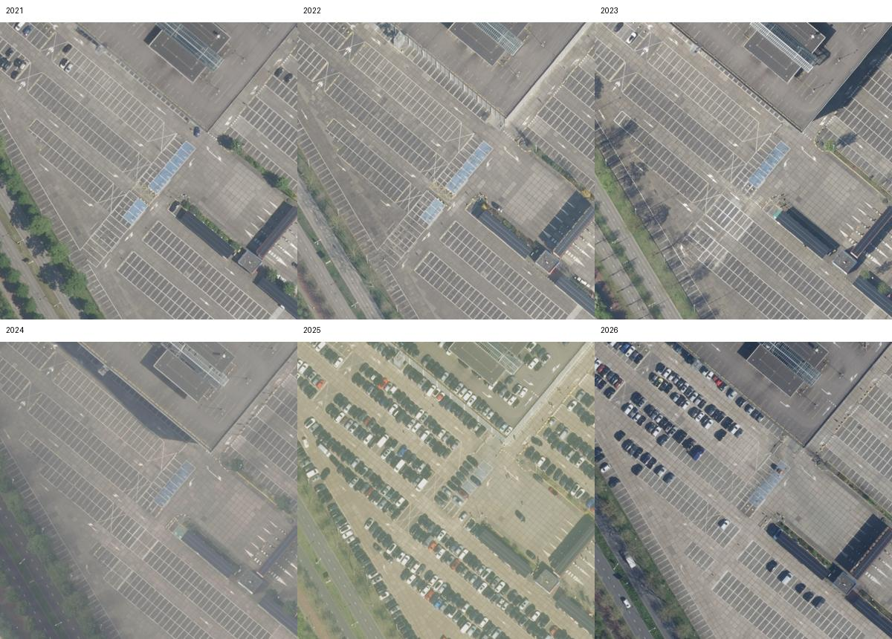
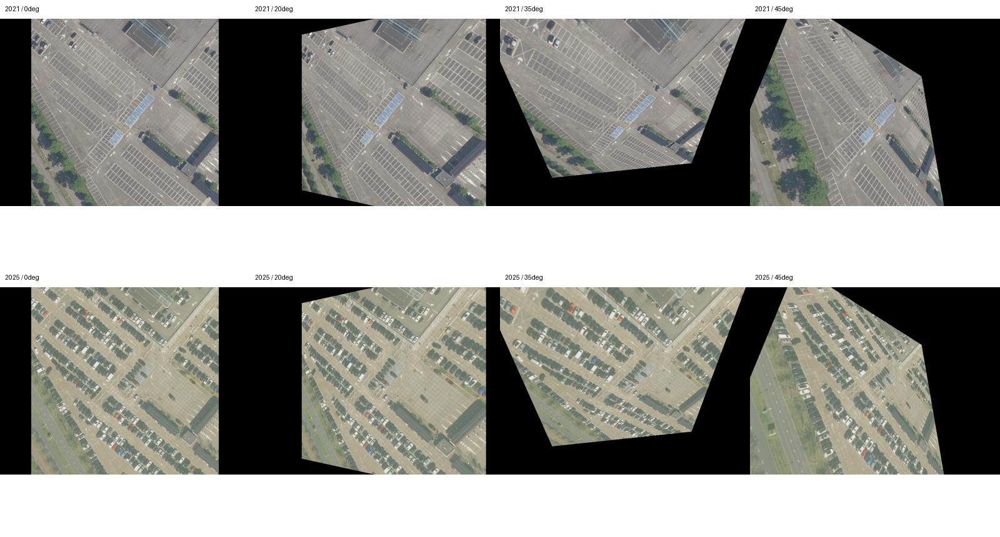
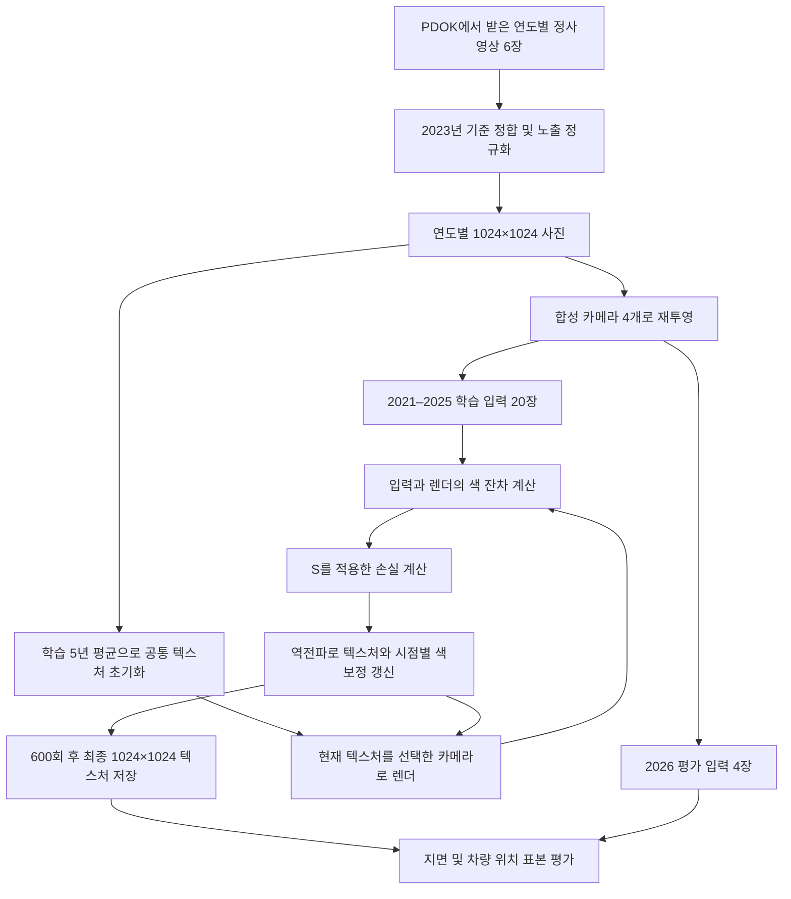
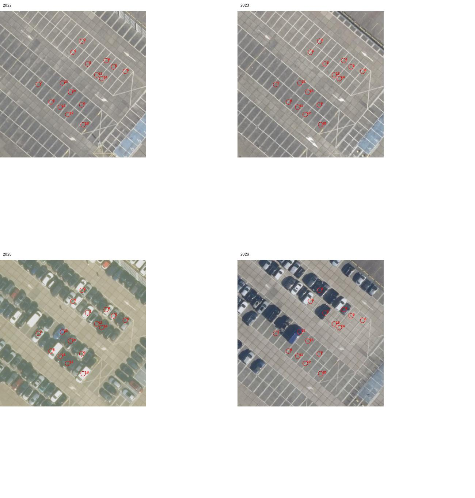
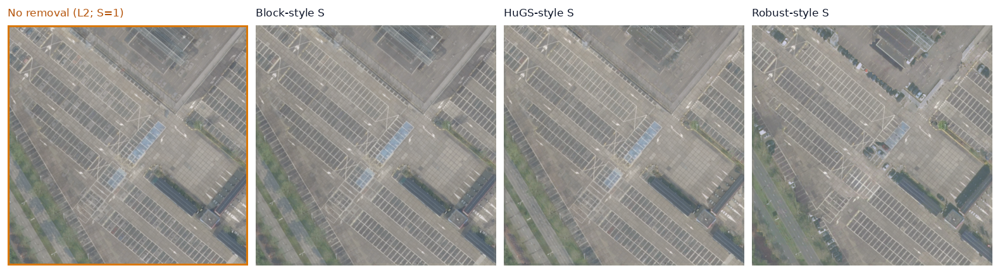
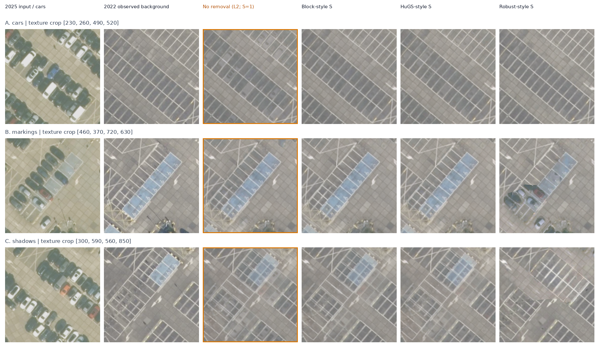
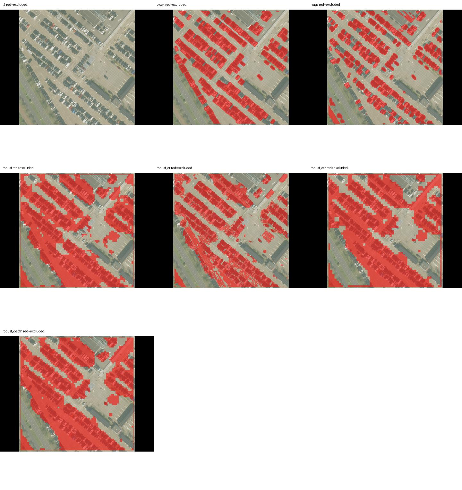
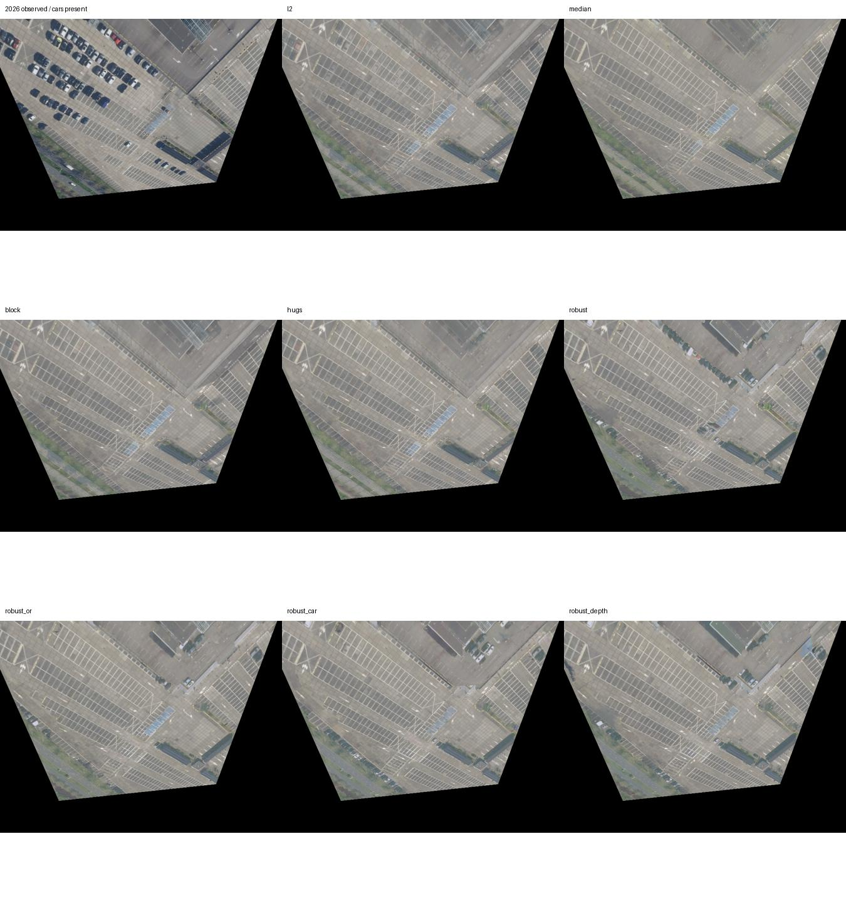

# 동적 차량 제거 S의 텍스처 베이킹 파일럿

실험일: 2026-10-25. 문서 재구성: 2026-10-26. 저장된 코드·지표·이미지를 기준으로 작성했다.

## 1. Intro

### 1.1 문제와 목표

같은 장소를 다른 시기에 촬영한 사진을 하나의 텍스처로 베이킹하면, 시기마다 달라지는 차량 색도 섞여 차량 잔상이 생길 수 있다. **차량이 있는 관측을 제외하고 다른 해의 빈 지면 관측을 사용하면 배경을 더 잘 복원할 수 있는가?** 이것이 이번 파일럿의 질문이다.

Block-NeRF, NeRF-HuGS, RobustNeRF에서 차용한 관측 가중치 S를 공통 베이킹 루프에 넣고 차량 잔상, 지면 디테일, 그림자와 관측 부족을 정성·정량 비교한다. 최종 산출물은 방법별 텍스처, 동일 영역 확대 이미지, S 마스크, 지표 표와 재현 가능한 코드다.

### 1.2 실험 범위와 비교 대상

실제 PDOK 다중 연도 항공 정사사진으로부터 합성 카메라 영상을 만든 **평면 텍스처 베이킹 실험**이다. 원 논문의 전체 NeRF를 학습한 실험은 아니다.

| 비교 대상 | 역할 |
|---|---|
| **제거 기법 미적용 — L2, S=1** | 모든 valid 관측을 사용하는 공통 베이킹 기준선 |
| Block-NeRF형 S | 차량 클래스 검출로 관측 제외 |
| NeRF-HuGS형 S | 특징점 반복 관측·색 잔차·SAM으로 관측 선택 |
| RobustNeRF형 S | 현재 잔차에 따라 매 반복 관측 선택. 기본·OR·차량 크기·깊이 적응 비교 |
| 시간 중앙값 | 정합된 학습 사진에서 직접 계산하는 별도 비학습 참고 기준선 |

본문은 **Method에서 데이터 출처·베이킹·평가 절차를 설명하고, Result에서 미적용 기준선을 포함한 이미지·표·관찰을 제시하는 순서**다.

## 2. Method

### 2.1 데이터 출처·장면 선정·전처리

#### 2.1.1 원본 이미지는 어디서 어떻게 가져왔나?

원본은 **네덜란드 PDOK의 공개 항공 정사영상 WMS**에서 내려받았다. 일반 웹 이미지 검색, Google Maps 화면 캡처, NeRF 논문 제공 장면을 사용한 것이 아니다. 제공 항공사진은 Beeldmateriaal Nederland의 영상이며 PDOK가 서비스한다. 출처·CC BY 4.0 안내 링크는 §2.7에 모았다.

사용한 서비스 주소:

```text
https://service.pdok.nl/hwh/luchtfotorgb/wms/v1_0
```

[download_selected.py](download_selected.py)는 최종 중심 위도 52.08235, 경도 5.1009 주변에서 반폭 60m에 해당하는 위·경도 범위를 근사 계산한 뒤, **같은 bbox로 연도별 레이어를 바꿔 7개의 GetMap 요청**을 보냈다. 따라서 모든 원본 파일은 같은 지역 범위를 요청한 결과다. WMS가 이미 정사보정·모자이크한 영상을 주기 때문에 개별 비행의 원시 카메라 사진·촬영 포즈를 다운로드한 것은 아니다.

| 요청 파라미터 | 실제 값 / 의미 |
|---|---|
| `service`, `request`, `version` | `WMS`, `GetMap`, `1.3.0` |
| `layers` | `2021_orthoHR`부터 `2026_orthoHR`, 추가 `2026_quickorthoHR` |
| `crs` | `EPSG:4326` |
| `bbox` | `52.081811013295,5.1000229260720555,52.082888986704994,5.101777073927945` |
| bbox 축 순서 | 이 요청의 WMS 1.3.0 / EPSG:4326 기준 위도 min, 경도 min, 위도 max, 경도 max |
| `width`, `height` | `1500`, `1500` |
| `styles`, `format` | 빈 styles, `image/png` 요청. 실제 수신 바이트는 JPEG |

실제로 기록된 2021년 요청은 다음과 같다. 다른 연도도 `layers`만 바꾼다.

```text
https://service.pdok.nl/hwh/luchtfotorgb/wms/v1_0?service=WMS&version=1.3.0&request=GetMap&layers=2021_orthoHR&styles=&crs=EPSG:4326&bbox=52.081811013295,5.1000229260720555,52.082888986704994,5.101777073927945&width=1500&height=1500&format=image/png
```

| 내려받은 파일 | 최종 실험에서 사용한 용도 |
|---|---|
| [2021_orthoHR.png](data/selected/2021_orthoHR.png) | 학습 입력 4장 생성, 초기 평균, 학습 중앙값, 평가 consensus |
| [2022_orthoHR.png](data/selected/2022_orthoHR.png) | 위와 동일 + 16개 차량 위치 표본의 실제 빈 배경 비교 기준 |
| [2023_orthoHR.png](data/selected/2023_orthoHR.png) | 학습·평가 구성 + 기하 정합·노출 정규화 기준 |
| [2024_orthoHR.png](data/selected/2024_orthoHR.png) | 학습 입력 4장 생성, 초기 평균, 학습 중앙값, 평가 consensus |
| [2025_orthoHR.png](data/selected/2025_orthoHR.png) | 학습 구성 + 차량 위치 표본 선택·차량 RGB 비교 기준 |
| [2026_orthoHR.png](data/selected/2026_orthoHR.png) | 시기 hold-out 입력 4장 생성, 평가 consensus. 베이킹 학습에서는 제외 |
| [2026_quickorthoHR.png](data/selected/2026_quickorthoHR.png) | 중복·독립성 확인용. 최종 학습·평가 consensus에서 제외 |

파일은 `data/selected/`에 저장했다. 같은 이름의 파일이 있으면 다운로드 스크립트는 기존 파일을 사용한다. 원본 응답별 **실제 URL·SHA-256·디코딩 형식**은 [provenance.json](results/provenance.json)의 `assets`에 남겼다. 최초 장면과 IKEA 후보 파일은 장면 검토용으로만 보존했고 최종 베이킹 입력과 섞지 않았다.

#### 2.1.2 후보와 최종 장면

| 후보 | 중심 위도·경도 | 판단 |
|---|---|---|
| 최초 Jaarbeurs 주차장 | 52.08718, 5.10243 | 2024년부터 공사장으로 바뀌어 제외 |
| IKEA 인근 산업지구 | 52.0758, 5.0470 | 건물과 상시 주차 차량이 많아 제외 |
| **Jaarbeurs 남쪽 주차장** | **52.08235, 5.1009** | 최종 사용. 여러 해의 빈 주차면과 2025년의 차량을 비교 가능 |

- 제공처: PDOK, Beeldmateriaal Nederland의 연도별 HR 항공 정사영상.
- 요청 영역: 120×120m, 1500×1500px. WMS 요청 격자는 약 8cm/px이며 원본 항공 촬영의 실제 해상도와 같은 뜻은 아니다.
- 학습: `2021_orthoHR`–`2025_orthoHR`의 5개 연도.
- 시기 hold-out: `2026_orthoHR`.
- `2026_quickorthoHR`도 받았으나 독립 촬영 여부가 확인되지 않아 제외했다. 정식 영상과 픽셀 상관 0.975, metadata UUID도 같았다. 바이트가 동일한 파일은 아니다.
- 연도는 레이어 이름이다. 정확한 비행일은 확인하지 않았다.
- WMS에 PNG를 요청했지만 실제 응답은 JPEG였다. 입력 확장자는 `.png`로 남아 있으며 디코더와 출처 기록에서 이를 명시했다.

#### 2.1.3 전처리와 카메라 생성

1. **기하 정합**: 2023년을 기준으로 SIFT 매칭과 RANSAC 유사변환을 추정했다. inlier 중앙 오차는 원본 기준 약 0.24–0.59px였다. 2025/2026의 inlier 수는 18/11개로 적으므로 장면 전체 정합 정확도를 보장하지는 않는다.
2. **노출 정규화**: 지면에서 강건한 채널별 gain/bias를 맞췄다. 처음 사용한 제약 없는 색 행렬 전처리는 일부 영상의 대비를 줄여 수정했다.
3. **합성 카메라**: 연도마다 기울기 0°/20°/35°/45°의 카메라 4개를 만들고 정사영상을 투영했다. 학습 20장, hold-out 4장이다.
4. **지면 평가 ROI**: 지붕처럼 평면 가정이 약한 곳을 피한 수동 polygon을 사용했다. 전체 텍스처의 50.7%다. 학습 valid 마스크와 평가 ROI는 서로 다른 개념이다.

같은 해의 네 영상은 같은 정사사진을 변형한 것으로 **독립적인 네 번의 촬영이 아니다**. hold-out도 새로운 해를 검증하며 카메라 자세 자체는 학습 때와 같은 네 가지다.





### 2.2 베이킹 모델과 실제 최적화 과정

메쉬 M, 카메라 πᵢ, 입력 영상 Iᵢ를 고정하고 텍스처 T를 최적화한다.

$$
L_{bake}(T)=\sum_i\sum_r S_i(r)\,\|R(M,T;\pi_i)(r)-I_i(r)\|_2^2.
$$

- **M**: 120×120m 지면 평면.
- **R**: 카메라 픽셀에서 지면 텍스처로 가는 homography와 PyTorch `grid_sample`.
- **T**: 최종 1024² 텍스처. 512² 텍스처 변수를 bilinear 보간한 공통 기저로 표현한다.
- **S=1**: 그 입력 픽셀을 학습에 사용한다.
- **S=0**: 그 입력 픽셀의 색 오차를 학습에서 제외한다.

구현에서는 시점별 affine 색보정 Aᵢ, bᵢ도 함께 학습한다. 실제 예측은 `Aᵢ R(M,T;πᵢ)+bᵢ`이며, 색보정이 identity에서 지나치게 벗어나지 않도록 공통 ridge 항을 추가했다. 데이터 손실은 S의 합이 아닌 valid 픽셀 수로 정규화한다. 모든 학습 기법이 같은 루프를 쓰고 S 생성 방식만 달리한다. 시간 중앙값은 별도의 비학습 참고 기준선이다.

차량 관측을 제외해도 다른 해에 지면이 보였다면 그 관측으로 채울 수 있다. 모든 해에 계속 가려진 지면을 S만으로 새로 알아낼 수는 없다.

#### 2.2.1 이 실험에서 “베이킹”한 것은 무엇인가?

연도마다 다른 차량이 찍힌 **여러 입력 영상의 색을 하나의 공통 지면 텍스처에 모으는 작업**이다. 연도별로 결과 텍스처를 따로 만드는 것이 아니라, 모든 학습 영상이 같은 T 하나를 공유한다. T를 각 카메라로 다시 렌더한 영상이 입력과 비슷해지도록 T의 RGB 값을 역전파로 갱신했다.

별도의 실측 3D 메쉬나 실제 항공 카메라 포즈를 받은 것은 아니다. 지면을 평면으로 가정하고 메쉬·UV·카메라를 코드에서 정의했다. 실제 사진은 PDOK 정사영상이고, 베이킹 입력으로 쓰는 사선 영상은 그 사진에서 합성했다.



#### 2.2.2 지면·UV·카메라와 입력 영상 만들기

1. **지면 좌표**: 장면 중심을 원점으로 놓고 `x,y∈[-60,60]m`, `z=0`인 정사각형을 정의했다. 텍스처 왼쪽 위에서 오른쪽 아래로 이 평면 전체가 대응하도록 UV를 정했다. 다운로드 영상의 지리 좌표는 영역 선택에 사용했고, 베이킹은 이 로컬 평면 좌표에서 수행했다.
2. **가상 카메라**: 장면 중심에서 거리 100m인 위치에 카메라를 놓고 원점을 바라보게 했다. 거리 100m는 모든 카메라의 고도가 100m라는 뜻이 아니다. 기울기에 따라 높이는 `100 cos(기울기)`로 달라진다. 초점거리는 480px, 출력 크기는 768×576, 주점은 이미지 중심이다.
3. **투영표 사전 계산**: 각 카메라 픽셀 `(u,v)`가 지면의 어느 위치를 보고, 그 위치가 텍스처의 어느 `(s,t)`에 대응하는지 homography의 역변환으로 계산했다. 텍스처 좌표를 `[-1,1]`로 정규화해 `grid_sample`용 grid를 저장했다. 카메라 전방 축 기준 깊이도 평면에서 계산했다.
4. **학습 입력 합성**: 같은 투영표로 각 연도 사진을 `cv2.remap`의 bilinear 보간으로 읽어 입력 영상 Iᵢ를 만들었다. 기법별 베이킹 중 이 Iᵢ는 고정된 정답 관측으로 취급했다. 렌더러 검산에서는 이 입력 합성과 `grid_sample` 결과의 수치적 일치를 확인했다.
5. **유효 영역 설정**: 정규화 텍스처 좌표의 절댓값 최댓값이 0.98 이하인 픽셀만 valid로 삼았다. 평면 밖이나 경계 여유 구역의 검은 픽셀은 손실에 넣지 않았다. 이 valid 영역은 차량을 판정하는 S나 지면 평가 ROI와 별개다.

| 카메라 번호 | 수직 방향에서 기울기 | 코드에서 정한 방위각 | 같은 카메라를 적용한 연도 |
|---|---:|---:|---|
| 0 | 0° | 0° | 2021–2026 |
| 1 | 20° | 0° | 2021–2026 |
| 2 | 35° | 100° | 2021–2026 |
| 3 | 45° | 220° | 2021–2026 |

방위각은 로컬 좌표에서 카메라 위치를 정하는 값이다. 실제 촬영기의 비행 방향을 추정한 값이 아니다. 대응 grid·깊이·valid는 [views.npz](results/views.npz), 카메라와 homography는 [cameras.json](results/cameras.json), 합성 영상은 `results/views/{연도}_{카메라번호}.png`에 저장했다.

#### 2.2.3 최적화 시작 전 무엇을 준비했나?

- **초기 텍스처**: 정합·노출 정규화된 2021–2025 사진의 산술평균을 구하고 512×512로 보간해 최적화 변수로 삼았다. 이 평균에는 차량 잔상이 포함될 수 있다. 깨끗한 배경 GT나 시간 중앙값으로 학습을 초기화한 것은 아니다.
- **색보정 변수**: 학습 입력 20장마다 3×3 행렬 Aᵢ와 RGB bias bᵢ를 두었다. Aᵢ는 identity, bᵢ는 0에서 시작했다. 2023년/카메라 0의 색보정은 기준으로 고정했다.
- **Block형 S**: 각 학습 입력의 차량 검출 마스크를 미리 계산하고 베이킹 중 고정했다.
- **HuGS형 S**: 먼저 별도의 공통 L2 베이킹을 600회 실행해 잔차를 얻고, SIFT·SAM과 결합해 정적 마스크를 준비했다. 최종 베이킹은 warm-up 텍스처를 이어받지 않고 공통 평균 초기화부터 다시 시작했다. 기저를 512²로 바꾼 최종 실행에서는 캐시의 SAM/SfM 영역을 재사용하되 새 L2 잔차로 static 결정을 갱신했다.
- **Robust형 S**: 고정 마스크를 준비하지 않고, 매 반복 현재 잔차에서 다시 계산했다.

2026년 사진과 6년 중앙값 consensus는 텍스처 초기화나 최적화 손실에 사용하지 않았다. 다만 2026년도 정합·노출 정규화와 평가 과정은 거쳤다. 2022년 빈 배경 표본 역시 별도의 학습 손실로 주지 않았다. 2022년 영상이 일반 학습 입력으로 들어간 것과는 구분해야 한다.

#### 2.2.4 실제 베이킹 반복 1회는 어떻게 진행됐나?

각 기법은 아래 과정을 **600번의 optimizer update** 동안 수행했다. “600회”는 학습 영상 20장을 모두 훑는 epoch 600번이라는 뜻이 아니다.

1. seed 42의 난수 생성기로 학습 입력 20장 중 서로 다른 4장을 뽑는다. 반복 사이에는 같은 영상이 다시 선택될 수 있다.
2. 현재 512² 텍스처 변수를 1024²로 bilinear 보간한다. 선택한 각 카메라 grid로 이 텍스처를 읽어 현재 렌더 영상 Rᵢ를 만든다.
3. 해당 입력의 색보정을 적용해 `Pᵢ=AᵢRᵢ+bᵢ`를 계산한다.
4. 고정 입력 Iᵢ와 비교해 픽셀별 RGB 평균 제곱 오차 `eᵢ=mean_RGB((Pᵢ−Iᵢ)²)`를 계산한다.
5. L2는 valid 전체, Block/HuGS는 고정 마스크×valid를 사용한다. Robust형은 `sqrt(eᵢ)`에서 S를 다시 구한다. S를 만드는 계산에는 gradient를 흘리지 않는다.
6. `sum(eᵢ×Sᵢ)/sum(validᵢ)`에 색보정 ridge 항을 더해 loss를 계산한다. S=0인 입력 픽셀은 그 반복의 색 오차 gradient를 텍스처에 전달하지 않는다.
7. 역전파하고 Adam으로 **공유 텍스처 변수와 시점별 색보정만** 갱신한다. 메쉬·카메라·입력 영상은 갱신하지 않는다. 색보정 기준 영상의 gradient는 0으로 둔다.
8. 텍스처 RGB를 `[0,1]`로 제한한 뒤 다음 반복으로 넘어간다.

실행 코드와 대응되는 축약 의사코드는 다음과 같다.

```python
texture = resize(mean(aligned_images[2021:2025]), (512, 512))
A, b = identity_per_training_image(), zeros_per_training_image()
for step in range(600):
    ids = rng.choice(20, size=4, replace=False)
    rendered = grid_sample(upsample(texture, (1024, 1024)), grids[ids % 4])
    prediction = apply_affine(rendered, A[ids], b[ids])
    error = mean_rgb((prediction - fixed_training_images[ids]) ** 2)
    S = method_mask(error, ids).detach() * valid[ids % 4]
    loss = (error * S).sum() / valid[ids % 4].sum() + color_ridge(A, b)
    loss.backward()
    freeze_reference_color_gradient()
    adam.step()
    texture.clamp_(0, 1)
```

원 코드에는 매 반복 gradient 초기화도 포함된다. 실제 함수는 [pilot.py의 bake()](pilot.py), 렌더링은 같은 파일의 `resolved()`·`render()`, Robust 가중치는 `robust()`다.

**차량이 사라지는 원리는 다른 해의 관측을 쓰는 것**이다. 예를 들어 같은 지면 위치가 2025년에는 차량, 2022년에는 포장면으로 보이면, 2025년 차량 픽셀의 S를 0으로 놓아 그 색을 제외하고 2022년 포장면 관측이 공유 T를 갱신하도록 한다. 실제 차량 형상을 메쉬에서 삭제하거나 차량 영역을 생성 모델로 덧칠한 실험은 아니다. 마스크 누락, 조명 차이, 잘못된 제외, 관측 부족이 있으면 잔상이나 품질 저하가 남는다.

#### 2.2.5 학습이 끝나면 무엇을 저장하고 평가했나?

600회 후 512² 변수를 보간한 **공통 1024² 텍스처 T**를 `results/textures/{method}.png`로 저장했다. 저장한 T에는 특정 입력의 Aᵢ·bᵢ를 덧씌우지 않았다. 시점별 색보정은 학습 관측의 색 차이를 설명하기 위한 별도 변수다.

최종 T로 학습 입력 20장을 다시 렌더해 최종 S·잔차·색보정 행렬을 `{method}_fit.npz`에 저장했다. 학습 손실·활성 마스크 비율·소요 시간은 `{method}_trace.json`에 기록했다. Robust 마스크는 학습 중 변하므로 이 파일의 S는 전체 학습의 누적 평균이 아닌 **최종 T에서 다시 계산한 값**이다.

그다음 저장된 텍스처를 읽어 지면 ROI·변화 proxy·16개 차량 위치 표본에서 지표를 계산하고, 2026년의 네 카메라로 렌더해 정적 영역 오차를 측정했다. 학습 5년의 직접 중앙값도 이 평가 단계에서 참고 결과로 만들었다. 비교 그림·마스크 오버레이·확대 crop·표를 마지막에 생성했다.

#### 2.2.6 L2가 정확히 무엇인가?

이 문서의 **L2 baseline은 차량을 구분하지 않고 모든 유효한 관측의 RGB 제곱 오차를 줄이는 기본 베이킹 방법**이다. 모델이나 검출기 이름이 아니다. `L2`라는 말이 때때로 가중치 정규화를 뜻하기도 하지만, 여기서 표에 적은 L2는 **색 재구성 손실의 종류**를 가리킨다.

**① L2 norm과 squared L2 loss**

렌더한 한 픽셀의 RGB를 P=(P_R,P_G,P_B), 입력 RGB를 I=(I_R,I_G,I_B)라고 하면 유클리드 거리인 L2 norm은 다음과 같다.

$$
\|P-I\|_2=\sqrt{(P_R-I_R)^2+(P_G-I_G)^2+(P_B-I_B)^2}.
$$

이번 베이킹 손실은 이 거리의 **제곱**을 사용한다. 코드에서는 RGB 세 채널의 평균을 구하므로 픽셀별 오차는 다음과 같다.

$$
e=\frac{1}{3}\|P-I\|_2^2
 =\frac{(P_R-I_R)^2+(P_G-I_G)^2+(P_B-I_B)^2}{3}.
$$

이를 선택한 입력 영상의 valid 픽셀 전체에서 평균 낸 것이 데이터 MSE다. 따라서 이번 문서의 “L2”는 정확히는 **squared L2 / RGB MSE 기반 baseline**이다. norm의 제곱근을 그대로 최소화한 실험이 아니다. PSNR은 이 오차를 바탕으로 계산하는 평가 지표이며 L2 학습 방법 자체와는 구분된다.

**② 코드에서 계산한 최종 baseline 손실**

```python
prediction = A_i @ rendered_rgb + b_i
error = ((prediction - input_rgb) ** 2).mean(dim=RGB_channel)
S = valid                          # L2 baseline: valid 영역에서는 전부 1
loss_data = (error * S).sum() / valid.sum()
loss = loss_data + 0.001 * (
    mean((A - identity) ** 2) + mean(b ** 2)
)
```

마지막 항은 모든 학습 방법에 공통인 색보정 ridge다. 표의 “L2 baseline”을 색보정 ridge만 적용하는 방법으로 해석하면 안 된다. baseline은 차량 관측을 판정하거나 제외하지 않으며, 평면 밖의 invalid 픽셀만 손실에서 뺀다.

**③ 왜 L2에서는 차량 잔상이 생길 수 있는가?**

색보정과 재표본화를 생략한 단일 텍셀 예를 생각하면 이해하기 쉽다. 같은 지면 위치가 5개 연도 중 4개에서는 회색 포장면 0.4, 한 해에서는 밝은 차량 0.8로 보였다고 하자. 각 값은 설명을 위해 RGB를 한 채널로 줄인 것이다.

$$
L(t)=4(t-0.4)^2+(t-0.8)^2.
$$

이 제곱 오차를 최소화하는 색은 관측의 평균인 `t=(4×0.4+0.8)/5=0.48`이다. 실제 빈 지면의 0.4보다 밝으므로 차가 있던 자리에 옅은 흔적이 남을 수 있다. 차량 관측을 S=0으로 제외하면 이 단순 예에서는 `t=0.4`를 학습할 수 있다. 실제 실험에는 보간·색보정·마스크·제한된 반복이 있어 최종 텍스처가 단순 산술평균과 정확히 같지는 않다.

**④ 다른 비교 방법도 기본 오차식은 같다**

| 방법 | RGB 제곱 오차 | 다른 점 |
|---|---|---|
| L2 baseline | 사용 | 모든 valid 관측을 사용: S=1 |
| Block형 / HuGS형 | 사용 | 미리 만든 S로 일부 관측 제외 |
| Robust형 | 사용 | 현재 잔차에서 매 반복 S를 다시 계산하고 고정한 채 갱신 |
| 시간 중앙값 | 이 베이킹 루프를 사용하지 않음 | 정합된 학습 사진의 채널별 중앙값을 직접 계산 |

즉 이 프로젝트는 **L2 손실을 쓰는 방법과 다른 종류의 손실을 쓰는 방법을 단순 비교한 것이 아니라, 공통 제곱 오차 베이킹에서 어떤 관측을 S로 선택하느냐를 비교한 실험**이다. Robust형도 선택된 관측에는 제곱 오차를 적용한다. 다만 S를 잔차에 따라 바꾸므로 전체 최적화 동작은 모든 관측을 평균내는 기본 L2와 달라진다.

### 2.3 공통 학습 조건

| 항목 | 최종 설정 |
|---|---|
| GPU | NVIDIA L40S-24Q, 24GB |
| Python / PyTorch | 3.11 / 2.5.1+cu121 |
| 난수 seed | 42 |
| 입력 영상 | 768×576, 학습 20장 |
| 출력 텍스처 / 최적화 기저 | 1024² / 공통 512² bilinear 기저 |
| 초기화 | 정합·노출 정규화된 학습 5년의 평균 텍스처 |
| 최적화 | Adam 600회, 매 반복 영상 4장 |
| 텍스처 / 색보정 lr | 0.025 / 0.001 |
| 시점별 색보정 | 3×3+bias, identity ridge 0.001 |
| 색보정 기준 고정 | 2023년 nadir 시점 |
| 추가 처리 | TV 정규화·생성형 inpainting 미사용 |

처음 native 1024² 변수를 직접 최적화했을 때 바둑판 모양의 고주파 잔상이 나타났다. 카메라 샘플 밀도와 텍스처 자유도의 불균형 가능성을 줄이기 위해 모든 학습 기법을 같은 512² 기저로 다시 실행했다. 최종 표는 이 공통 조건의 결과다. 이를 1024²의 독립적인 텍셀을 모두 최적화한 결과로 표현하면 안 된다. 초기 진단 결과 일부는 `results/native1024_debug/`에 보존했다.

### 2.4 비교 기법과 S 구현

#### 2.4.1 L2와 시간 중앙값

- **L2 baseline**은 모든 valid 픽셀의 RGB 평균 제곱 오차(MSE)를 최소화하는 기본 베이킹이다. 차량을 구분하지 않는다. 수식·코드·잔상 발생 예시는 §2.2.6에 정리했다.
- 시간 중앙값은 정합된 **학습 5년**의 RGB 채널별 중앙값이다. 베이킹 최적화와 합성 카메라 재표본화를 거치지 않는다.

#### 2.4.2 Block-NeRF형: 차량 클래스 마스크

DOTA 사전학습 YOLO11s-OBB로 각 합성 영상의 small/large vehicle을 검출했다. confidence 0.25, 최대 검출 1000, OBB polygon에 5×5 팽창을 적용하고 해당 픽셀을 S=0으로 만들었다.

원 Block-NeRF의 Panoptic-DeepLab을 항공영상용 검출기로 대체한 것이다. 포즈가 알려져 있어 COLMAP 마스킹은 생략했다. 차량이면 주차된 정지 차량도 제외한다. 차량 그림자를 별도 클래스로 처리하지 않는다.

#### 2.4.3 NeRF-HuGS형: 반복 관측 + 잔차 + SAM

1. 20장 모든 쌍을 SIFT로 매칭한다. ratio 0.75, homography RANSAC 2px로 검증한다.
2. 자기 영상 포함 5개 이상 영상의 지지를 받은 특징점을 정적 후보로 삼고 SAM point prompt로 영역을 만든다. 이 장면에서 정규화된 기준은 5/20=0.25다.
3. 공통 L2 600회 warm-up의 잔차로 평균 이하 영역과 0.95 quantile 이하 영역을 만든다.
4. 정적 특징 영역과 평균 이하 잔차 영역을 합치고, upper 잔차 영역으로 제한한다.
5. SAM 분리 영역 중 정적 후보 비율이 0.5 이상인 것을 채택한다. smooth 7 / erode 5도 적용한다.

SAM은 ViT-B, 자동 분할 64 points/side, crop 1, IoU 0.8, stability 0.9다. 원 COLMAP 3D track은 이 평면 실험에서 검증된 2D 매칭 빈도로 대체했다. upper 잔차에 base를 합치는 공식 구현의 예외도 반영했다.

HuGS의 최종 텍스처는 warm-up 결과를 이어받지 않고 다른 기법과 같은 평균에서 다시 600회 학습했다. **추가 warm-up·SIFT·SAM 비용이 있으므로 전체 계산량까지 같은 비교는 아니다.**

#### 2.4.4 RobustNeRF형: 현재 잔차로 S 갱신

기본 버전은 매 반복 다음을 수행하고 S를 stop-gradient로 사용한다.

1. 영상별 valid 잔차의 median 이하를 임시 inlier로 선택한다.
2. 3×3 box 평균이 0.5 이상이면 이웃 inlier로 판정한다.
3. 16×16 문맥의 inlier 평균이 0.6 이상이면 해당 8×8 내부 타일을 사용한다.

추가 변형도 비교했다.

| 변형 | 내용 |
|---|---|
| OR | 저잔차·이웃·패치 판정을 OR로 합침. 공식 MultiNeRF 코드의 해석을 반영 |
| 차량 크기 | 영상별 중앙 깊이 D와 차량 길이 4.5m로 k=ceil(4.5×480/D), 내부 타일 약 k/2 |
| 깊이 적응 | 픽셀별 깊이로 k를 구해 8–64로 제한. integral image 가변 box 평균 사용. 내부 결정 타일은 8×8 고정 |

기본 식은 전달된 서베이의 게재본 해석을 따랐다. OR 버전도 영상별 median·고정 타일의 베이킹용 차이가 있으며, 공식 NeRF 학습을 그대로 실행한 것은 아니다. 깊이 적응형 역시 문맥 크기만 깊이에 따라 바꾼 제안 변형이다.

### 2.5 평가 설계와 지표

| 지표 | 영역 / 비교 기준 | 해석과 주의점 |
|---|---|---|
| 차량 위치 표본 PSNR | 16개 원형 표본 / 실제 2022년 빈 배경 | 국소 배경 복원 검사. 차량 전체 제거율 아님 |
| 차량 위치 표본 ghost | 같은 표본 / 2022년 빈 배경과 2025년 차량 색 | 빈 배경보다 차량 RGB에 더 가까운 출력 픽셀 비율. 낮을수록 좋음 |
| 지면 ROI PSNR·SSIM | 지면 polygon / **6년 전체** 중앙값 consensus | consensus는 깨끗한 정답 GT가 아닌 대용 기준 |
| 지면 ROI LPIPS | ROI 밖을 consensus로 대체한 영상 쌍 | 진단용 masked 입력 LPIPS. 표준 전체 LPIPS는 CSV에 별도 저장 |
| 변화 영역 PSNR | 학습 연도 중 consensus와 RGB RMS 차이>0.12인 영역의 합집합 | 차뿐 아니라 그림자·조명·정합 오차도 포함 |
| S 제외 precision/recall | 각 학습 영상의 변화 proxy와 S=0 비교 | 차량 semantic GT에 대한 precision/recall 아님 |
| 2026 정적 영역 PSNR | 2026과 consensus의 RGB RMS 차이<0.06인 지면 | 표는 추가 hold-out affine fitting 없는 값. 관측 기반 정적 영역 선별의 한계가 있음 |
| 결과 차량 검출 수 | 결과 텍스처의 지면 ROI | 입력 마스킹과 같은 DOTA 검출기이므로 편향. 0건이어도 잔상 제거를 보장하지 않음 |
| 무지지 영역 비율 | 최종 S에서 어떤 관측도 지지하지 않는 지면 텍셀 | 기저 보간의 영향은 받을 수 있음. 생성형 배경 복원 결과가 아님 |

차량 위치 표본 ghost와 변화 영역 전체 ghost는 평가 영역·비교 기준이 다르다. 각각 `manual_metrics.csv`의 `manual_core_ghost_fraction`, `metrics.csv`의 `ghost_score`로 구분한다.

변화 proxy는 지면 ROI의 28.2%, 2026 정적 평가 영역은 지면 ROI의 74.3%다. consensus에는 2026도 포함되므로 이 기준을 이용한 hold-out 평가가 깨끗한 독립 정답 평가와 같지는 않다. 지면 ROI와 이미지 전체 지표도 구분해야 한다. `metrics.csv`의 `*_full`은 지붕 등을 포함한 텍스처 전체 값이다.

#### 2.5.1 차량 위치 표본의 정의 — 이전 “차량 내부” 표현 설명

이전 보고에서 쓴 **“차량 내부 PSNR”은 오해하기 쉬운 이름**이었다. 자동차 실내를 복원한 것이 아니다. 정확한 명칭은 **“차량 위치 표본의 배경 복원 PSNR”**이다.

평가 표본은 다음과 같이 만들었다.

1. 정합된 2025년 항공영상에서 차 몸체가 보이는 위치 16개를 에이전트가 시각적으로 골랐다.
2. 각 위치에 최종 1024×1024 텍스처 좌표 기준 **반경 5텍셀의 작은 원**을 그렸다. 차량 전체를 둘러싼 마스크가 아니다.
3. 같은 좌표가 2022년 영상에서는 빈 주차면으로 보이는지 그림으로 대조했다.
4. 결과 텍스처의 해당 작은 원 영역 RGB를 정합·색 정규화된 **2022년의 빈 주차면 RGB**와 비교했다.

```text
2025년: 차 몸체가 보이는 위치 p
2022년: 같은 위치 p에서 보이는 빈 주차면
결과 T: 위치 p가 차의 흔적보다 빈 주차면에 가까워졌는가?
```

따라서 이 지표가 높다는 것은 **선택한 차량 위치의 작은 표본이 실제로 관측된 빈 배경과 비슷하다**는 뜻이다. 차량 전체 외곽, 그림자, 모든 주차면의 제거 성공을 뜻하지 않는다. 16대의 작은 원을 평가했으므로 “16대 전체가 완벽히 제거됐다”는 의미도 아니다.

이 표본은 사람이 독립 검수한 정답 라벨이 아니라 에이전트가 고른 보조 평가다. 비교 기준인 2022년은 학습에도 사용했으므로 **미관측 배경에 대한 독립 테스트가 아니다**. 몸체가 있던 위치를 복원했는지 직접 확인하기 위한 검사다. 저장된 CSV의 `manual_core_*` 열 이름은 기존 코드와의 호환성을 위해 유지했다.



표본 정의: [manual_annotations.json](results/manual_annotations.json). 계산: [audit_metrics.py](audit_metrics.py). 표본 선택 코드: [manual_check.py](manual_check.py).

### 2.6 실행 순서·재현·구현 검산

#### 2.6.1 실제 진행 순서와 최종 실행의 차이

실제로는 처음부터 최종 설정 한 번만 실행한 것이 아니다. 아래 탐색을 거쳐 최종 공통 조건을 정했다.

1. 서베이와 구현을 확인하고 최초 Jaarbeurs 영상을 받았다. 연도 비교에서 공사를 발견해 장면을 제외했다.
2. IKEA 후보를 받아 건물·상시 주차 조건을 확인한 뒤, Jaarbeurs 남쪽으로 최종 장면을 옮겼다.
3. 정합·입력 생성·첫 베이킹을 실행했다. 전처리 색 행렬이 일부 영상의 대비를 줄이는 문제를 발견해 강건한 채널별 노출 보정으로 바꿨다.
4. native 1024² 베이킹의 고주파 잔상을 확인하고 모든 학습 방법에 공통 512² 기저를 적용했다.
5. 최종 기저의 L2 600회 잔차로 HuGS 결정을 갱신하고 모든 방법을 공통 초기화·600회로 다시 베이킹했다. 최종 CSV와 결과 그림은 이 마지막 조건에 해당한다.
6. 16개 차량 위치 표본, 전체·지면·hold-out 지표, 구현 검산을 저장하고 문서와 결과 묶음을 만들었다.

`run.sh`는 위 탐색 과정을 반복하지 않고 **확정된 최종 장면과 조건**을 재현하는 스크립트다. 이번 문서 보강에서는 영상 다운로드나 GPU 실험을 새로 실행하지 않았다.

#### 2.6.2 최종 조건 재실행

설치는 [README.md](README.md), 패키지 버전은 [requirements.lock](requirements.lock)을 따른다. 환경을 준비한 뒤 다음을 실행한다.

```bash
cd /root/sonjooho/baking_pilot
bash run.sh
```

`run.sh`의 순서는 다음과 같다.

```text
다운로드 → 정합·색 정규화·카메라 생성 → 차량 검출
→ L2 warm-up → SIFT/SAM HuGS 마스크 생성·잔차 갱신
→ Block/HuGS/Robust 4종 베이킹
→ 16개 표본 정의 → 공통 지표·표본 지표 계산
→ 구현 검산 → 환경·출처 기록 → 보고서·그림 생성
```

입력·SIFT·SAM 설정을 바꾸면 `results/sam_cache/`를 다른 이름으로 옮기고 다시 생성해야 한다. 저장된 static 결정을 그대로 재사용하면 새 조건과 맞지 않을 수 있다. `refresh_hugs`는 저장된 SAM/SfM 영역을 유지하며 새 warm-up 잔차로 정적 결정을 갱신한다.

최종 저장된 구현 검산은 다음과 같다.

| 검사 | 결과 |
|---|---:|
| homography 투영 역변환 최대 오차 | 약 0.000119px |
| 합성 입력과 differentiable renderer RGB RMSE | 약 8.3×10⁻⁷ |
| 가변 box 평균과 직접 계산 최대 차이 | 약 0.000282 |
| S의 shape·이진성·유한값·valid 영역 | 통과 |

이는 구현의 수치적 일관성을 확인한 결과이며, 실제 장면의 정합 정확도나 차량 제거 성공률을 보증하는 검사는 아니다.

### 2.7 출처

실험 설계는 전달된 `S_oracle_survey.pdf` §7을 기준으로 했다. 원문 텍스트 추출본은 [survey.txt](survey.txt)에 있다.

- 항공영상: © Beeldmateriaal Nederland, PDOK 제공. [PDOK 데이터 소개](https://www.pdok.nl/introductie/-/article/pdok-luchtfoto-rgb-open-), [CC BY 4.0 안내](https://www.beeldmateriaal.nl/dataroom). 정합·색 정규화·투영·베이킹으로 가공했다.
- [NeRF-HuGS 공식 마스크 구현](https://github.com/cnhaox/NeRF-HuGS/blob/master/HuGS/generate_static_mask.py).
- [MultiNeRF의 RobustNeRF 마스크 구현](https://github.com/google-research/multinerf/blob/main/internal/robustnerf.py).
- [Ultralytics OBB](https://docs.ultralytics.com/tasks/obb/), [Segment Anything](https://github.com/facebookresearch/segment-anything).

### 2.8 코드와 산출물 지도

프로젝트 실제 경로: `/root/sonjooho/baking_pilot/`. 이전 답변의 `/root/project/baking_pilot/` 링크 대신 현재 경로를 사용한다.

| 파일 / 폴더 | 역할 |
|---|---|
| `PROJECT.md` | 이 통합 문서 |
| `README.md` | 설치·실행 안내 |
| `SUMMARY.md`, `REPORT.md`, `REPORT.html` | 짧은 보고, 상세 보고, 이미지 내장 HTML |
| `scene.json` | 장면 위치·연도 split·지면 polygon·crop |
| `download_selected.py` | 최종 장면 7개 레이어 다운로드 |
| `download.py`, `download_ikea.py` | 제외한 후보 장면 다운로드 |
| `pilot.py` | 정합, 투영, 검출, HuGS, 베이킹, 평가 |
| `manual_check.py`, `audit_metrics.py` | 16개 표본 정의·표본 지표 계산 |
| `validate.py` | 투영·렌더러·가변 box·마스크 검사 |
| `provenance.py` | 환경·원본 URL·체크섬·중복 진단 기록 |
| `make_report.py`, `finalize.py` | 보고서·요약·그림·표 생성 |
| `qualitative_comparison.py` | 저장된 최종 결과로 미적용 L2 포함 정성 비교 패널 생성 |
| `results/qualitative_no_removal_*.png` | 미적용 기준선을 명시한 전체·동일 좌표 확대 패널 |
| `run.sh` | 전체 단계 실행 |
| `data/selected/` | 최종 장면 원본 응답 이미지 |
| `weights/` | SAM ViT-B, YOLO11s-OBB 가중치 |
| `results/textures/` | 방법별 최종 1024² 텍스처 |
| `results/renders/` | hold-out 연도 카메라 렌더 |
| `results/*_fit.npz` | 방법별 최종 S·잔차·색보정 |
| `results/sam_cache/` | 재사용 가능한 SAM 분할·SfM 영역 |
| `results/alignment.json`, `cameras.json` | 정합 변환·카메라 파라미터 |
| `results/provenance.json`, `validation.json` | 실행 환경·출처·검산 |
| `baking_pilot_results.zip` | 코드·문서·원본·주요 결과 묶음. 환경·대형 중간 배열·모델 가중치 등은 제외 |

## 3. Result

### 3.1 Qualitative comparison — 미적용 결과와 같은 위치 비교

#### 3.1.1 “제거 기법 미적용” 결과의 의미

**아래 그림에서 주황 테두리의 `No removal (L2; S=1)`이 차량 제거 기법을 적용하지 않은 베이킹 결과다.** 파일은 [l2.png](results/textures/l2.png)다. Block/HuGS/Robust 마스크 없이 valid 관측을 모두 사용했다. 공통 전처리·색보정·초기화·512² 기저·600회 최적화는 다른 학습 기법과 동일하다. 따라서 S를 적용했을 때 무엇이 달라지는지 비교하는 기준선이다.

2025년 사진은 **차량이 있는 입력 관측**, 2022년 사진은 **실제로 관측된 빈 배경의 참고 사진**이다. 두 사진은 알고리즘의 베이킹 결과가 아니다. 시간 중앙값도 S를 쓰지 않는다는 의미에서 기본 L2와 혼동하면 안 된다. 중앙값은 별도의 시간 통합 방법이다.

#### 3.1.2 전체 텍스처 비교

왼쪽부터 **미적용 L2 → Block형 → HuGS형 → 기본 Robust형**이다. 동일한 1024² 출력 텍스처를 같은 크기로 표시했다.



전체 장면에서는 차가 있던 자리의 잔상뿐 아니라 주차선의 연결, 지면 밝기, 국소적으로 남는 차량 흔적을 함께 봐야 한다. 기본 Robust형의 작은 차량 표본 PSNR이 높아도 전체 텍스처가 항상 가장 깨끗한 것은 아니다.

#### 3.1.3 차량·주차선·그림자 영역의 같은 좌표 확대

각 행의 열 순서는 다음과 같다.

1. **2025 input / cars**: 차량이 보이는 실제 입력 관측.
2. **2022 observed background**: 같은 위치의 빈 배경 참고 관측.
3. **No removal (L2; S=1)**: 차량 제거 미적용 베이킹 결과. 주황 테두리.
4. **Block-style S**: 클래스 마스크를 적용한 베이킹 결과.
5. **HuGS-style S**: 일관성·잔차·SAM 마스크를 적용한 베이킹 결과.
6. **Robust-style S**: 기본 잔차 적응 마스크를 적용한 베이킹 결과.

각 행은 모든 열에서 같은 텍스처 좌표와 배율을 사용했다. 기존 `scene.json`의 crop을 그대로 사용했고, 기법마다 밝기를 따로 맞추거나 결과를 보정하지 않았다. 아래 이미지를 원본 크기로 열면 작은 잔상과 주차선을 비교하기 쉽다.



| 영역 | 미적용 L2에서 보이는 것 | S 적용 결과와의 정성 비교 |
|---|---|---|
| **A. 차량 위치** `[230,260,490,520]` | 빈 주차면 위로 어두운 차량 모양이 옅게 겹쳐 보인다. | Block형은 흔적을 줄이지만 일부 밝고 어두운 잔상이 남는다. HuGS형과 기본 Robust형은 이 crop에서 차량 실루엣이 더 약해지고 지면 패턴이 드러난다. 이 위치의 개선만으로 전체 차량 제거를 판정하지 않는다. |
| **B. 파란 주차면·주차선** `[460,370,720,630]` | 파란 주차면과 흰 선은 보이지만 차량 흔적이 섞여 있다. | Block/HuGS형은 이 영역에서 눈에 띄는 차량 흔적을 줄이며 주차면이 보인다. **기본 Robust형에는 파란 주차면 아래쪽에 차량 모양·색이 뚜렷하게 남는 실패 사례**가 있다. L2보다 모든 위치에서 낫다고 할 수 없다. |
| **C. 명암·그림자 확인 영역** `[300,590,560,850]` | 어두운 띠와 차량 흔적이 주차선에 겹친다. | Block형만으로 명암 흔적이 모두 사라지지는 않는다. HuGS형에서도 일부 잔상·명암이 남는다. 기본 Robust형은 흰 선이 강하게 보이는 부분과 지면 명암의 불연속이 보여, 차량 억제와 자연스러운 배경 복원이 같은 문제가 아님을 보여준다. 그림자 전용 GT가 없어 제거율을 확정하지 않는다. |

위 설명은 저장된 이미지를 시각적으로 대조한 관찰이다. 좌표는 1024² 텍스처의 `[x0,y0,x1,y1]`다. crop 이름 `shadows`는 확인하려고 고른 영역명이며 해당 영역 전체가 그림자 정답 마스크라는 뜻은 아니다. 2022년에도 조명·그림자는 존재하므로 모든 사진 간 밝기 차이를 차량 잔상으로 해석하지 않았다.

#### 3.1.4 전체 변형·S 마스크·hold-out 렌더

시간 중앙값과 Robust OR/차량 크기/깊이 적응까지 포함한 [전체 비교](results/comparison.jpg), [차량 crop](results/crop_cars.jpg), [주차선 crop](results/crop_markings.jpg), [그림자 crop](results/crop_shadows.jpg)에도 동일한 L2 기준선이 포함돼 있다.





기본 Robust형은 넓은 영역을 제외하고 Block/HuGS형과 다른 관측을 선택한다. 이 차이가 모든 영역의 품질 향상으로 이어지지는 않는다. hold-out 그림도 입력에 찍힌 차량 수와 출력 검출 수만으로 성공을 판정하지 않고 정적 지면과 함께 확인한다.

### 3.2 Quantitative comparison — 정량 결과

| 방법 | 차량 위치 표본 PSNR↑ | 지면 ROI PSNR↑ | 지면 ROI SSIM↑ | 지면 ROI LPIPS↓ | 2026 정적 영역 PSNR↑ | 결과 차량 검출 수* |
|---|---:|---:|---:|---:|---:|---:|
| **미적용 — L2, S=1** | 27.27 | 30.38 | 0.920 | 0.038 | 27.18 | 9 |
| 시간 중앙값 | 35.69 | 37.57 | 0.974 | 0.013 | 29.12 | 0 |
| Block형 S | 31.56 | 30.85 | 0.934 | 0.033 | 27.30 | 0 |
| HuGS형 S | 32.81 | 32.45 | 0.931 | 0.032 | 27.90 | 0 |
| Robust형 / 기본 식 | 38.02 | 28.06 | 0.882 | 0.062 | 26.81 | 18 |
| Robust형 / OR | 38.09 | 29.96 | 0.904 | 0.045 | 27.78 | 3 |
| Robust형 / 차량 크기 | 38.12 | 29.90 | 0.903 | 0.046 | 27.23 | 7 |
| Robust형 / 깊이 적응 | 37.78 | 29.03 | 0.896 | 0.053 | 27.21 | 11 |


PSNR 단위는 dB다. **차량 위치 표본 열은 전체 차량을 평가한 것이 아니다.** *차량 검출 수는 편향된 보조 지표다.

표를 해석하면 다음과 같다.

- **차량 위치 표본**: 기본 Robust형은 L2보다 10.75dB 높았다. 다만 OR/차량 크기 버전과의 작은 차이에 통계적 의미를 부여할 근거는 없다.
- **넓은 지면 품질**: 학습형 중 HuGS형이 지면 PSNR·LPIPS에서, Block형이 지면 SSIM에서 가장 높았다. “HuGS가 모든 품질 지표에서 최고”라는 결론은 아니다.
- **기본 Robust형의 손해**: 표본에서는 좋았지만 지면 PSNR·SSIM·LPIPS와 2026 정적 PSNR은 L2보다 나빴다. 장면의 다른 곳에 남은 차량 흔적, 그림자, 과도한 제외와 디테일 손실을 함께 봐야 한다.
- **시간 중앙값**: 이 장면에서 강한 참고 기준선이다. 직접 정사영상에서 계산했고 평가 consensus도 중앙값이라 유리하다. 다른 점유율·실제 3D 다시점 장면에서도 이 순위가 유지된다는 뜻은 아니다.

전체 수치: [metrics.csv](results/metrics.csv). 표본 수치: [manual_metrics.csv](results/manual_metrics.csv). 확대 결과: [차량](results/crop_cars.jpg), [주차선](results/crop_markings.jpg), [그림자](results/crop_shadows.jpg). 잔차: [residuals.jpg](results/residuals.jpg).

### 3.3 관찰 요약과 적용 판단

이번 장면에서 확인한 결과는 다음과 같다.

- 차량이 있었던 작은 표본 위치에서는 세 S 모두 L2보다 빈 배경과의 일치도가 높았다. 기본 Robust형의 표본 PSNR은 L2 27.27 → 38.02dB였다.
- 학습 기법 중 **지면 ROI PSNR은 HuGS형 32.45dB**가 가장 높았다. 기본 Robust형은 28.06dB로 L2의 30.38dB보다 낮았다. 차량 위치의 국소 복원과 넓은 지면 품질의 순위가 달랐다.
- 직접 계산한 시간 중앙값은 지면 ROI PSNR 37.57dB로 가장 높았다. 빈 주차면이 여러 해에 관측되고 평가 기준도 중앙값이라는 점에서 유리한 비교 대상이다.
- **전체 장면에서 모든 차량·그림자가 제거됐다고 결론 내릴 수 없다.** 작은 표본의 개선을 전체 차량 제거율로 해석하면 안 된다. 기본 Robust형 결과의 차량 검출 수도 18건으로, L2의 9건보다 많았다. 이 검출 지표 자체에도 편향이 있다.
- 차량 크기·깊이 적응이 고정 Robust형보다 확실히 좋다는 근거는 얻지 못했다.

### 3.4 한계와 아직 입증하지 못한 것

1. 최종 장면 하나, seed 하나다. 반복 실험·신뢰구간·다른 장면 검증은 없다.
2. 16개 작은 원 표본이 차량 전체·장면 전체를 대표하지 않는다. 독립적인 사람 검수도 없다.
3. 실제 사선 촬영이 아닌 평면 재투영이다. 차량의 높이, 건물 parallax, 가림 관계를 재현하지 않는다.
4. 학습 5년 중 4년에 빈 주차면이 많아 시간적 outlier 제거에 유리하다. 다양한 차량 점유율 조건을 검증하지 않았다.
5. 계속 차량이 가리는 지면을 복원하는 실험은 충분하지 않다. 검출 기준 5년 모두 차량인 ROI가 0%였지만 검출 누락 가능성도 있다.
6. consensus GT는 색·조명·그림자·정합 오차를 포함한다. 이를 정답으로 둔 지표만으로 차량 제거 성능을 확정할 수 없다.
7. 원 논문의 segmentation/SfM/학습 구조를 베이킹에 맞게 바꿨다. 결과를 원 논문 전체의 우열로 일반화할 수 없다.
8. 깊이 적응형의 3D 효과와 하이퍼파라미터 민감도를 검증하지 않았다.

현재 결론은 **“선택한 차량 위치에서 배경 복원이 개선됐으며, 국소 차량 억제와 넓은 지면 품질 사이에 상충이 관찰됐다”**까지다.

### 3.5 다음 실험 — 아직 수행하지 않음

- 차량 전체 polygon과 그림자를 구분한 사람 검수 라벨을 만들고, 작은 원 표본과 별도로 평가한다.
- 도로·주차선의 정적 영역 품질과 차량 영역 복원을 분리해 보고, 여러 seed·장면·점유율에서 반복한다.
- 평면 중앙값에 유리한 조건을 넘어 실제 사선 다중 시기 영상으로 검증한다.
- Robust의 영역 제외로 관측 지지가 끊기는 곳을 분석하고, S 임계값과 차량 크기 문맥을 조정한다.
- 실제 차량 외곽·크기를 기준으로 깊이 적응 커널이 맞는지 검증한다. 고정 타일과 깊이별 타일도 별도로 비교한다.
- 학습에 사용하지 않은 깨끗한 배경 관측을 확보해 독립 평가를 강화한다.
