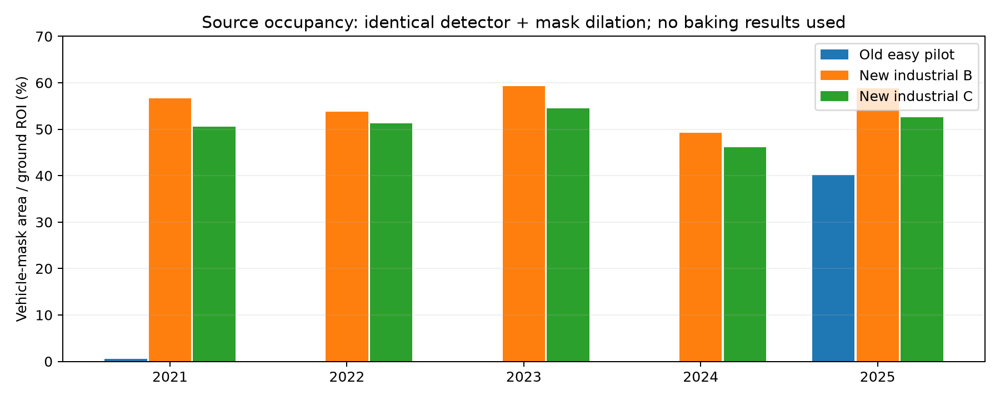
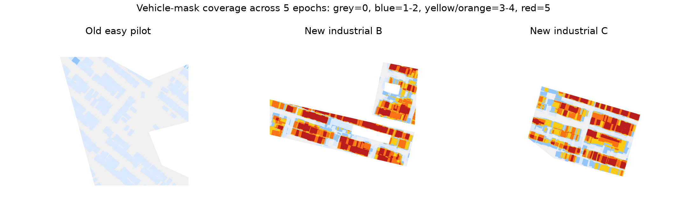
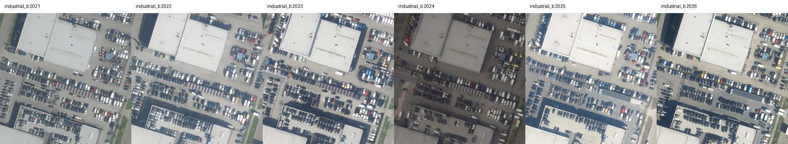
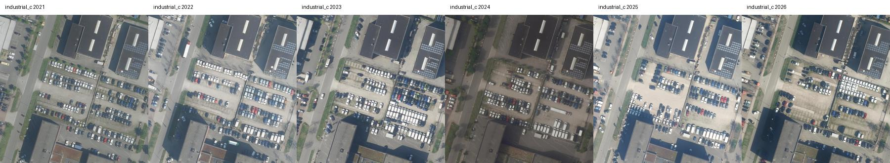
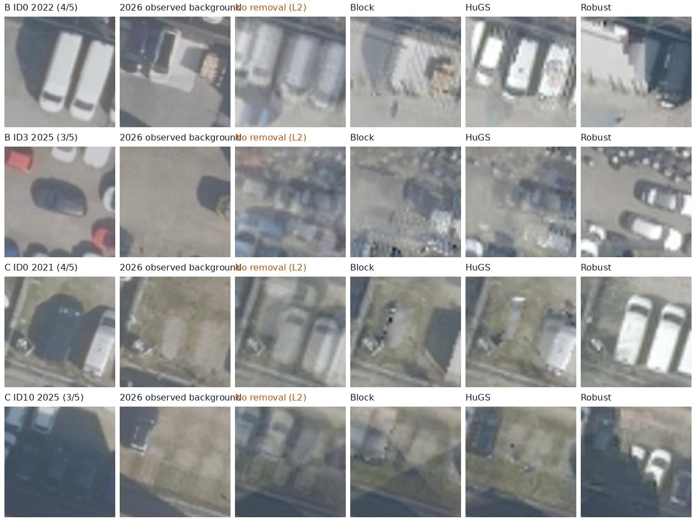
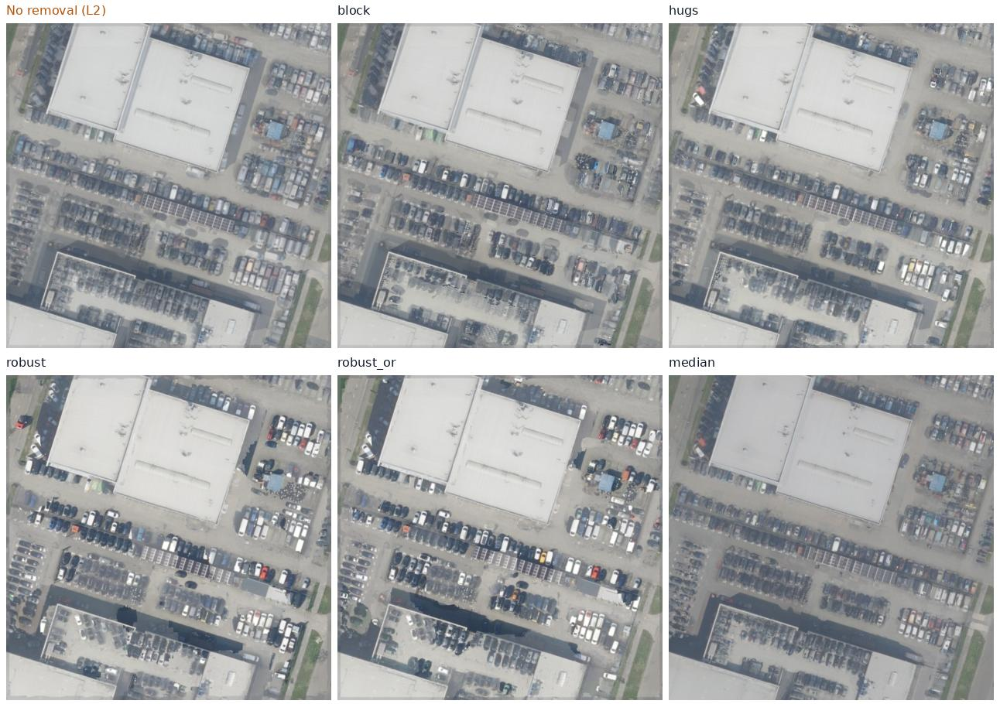
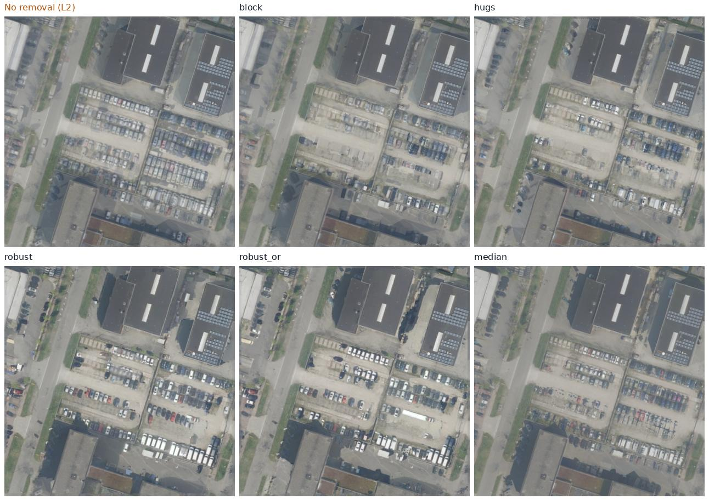

# 고점유 다중 시기 데이터에서의 차량 제거 베이킹 추가 실험

실행일: 2026-10-26. **Intro → Method → Result** 순서로 정리했다. 기존 쉬운 장면 결과는 [선행 파일럿 문서](harder_dataset/../PROJECT_EASY_PILOT.md)에 보존했다.

## 1. Intro

### 1.1 왜 다시 비교했나?

이전 Jaarbeurs 실험은 차량이 있던 위치 대부분이 학습 5년 중 한 해에만 가려졌다. 사용자가 지적한 대로 빈 배경이 다수이면 미적용 L2도 단순 평균 효과로 차량을 희석할 수 있다. 따라서 **차량이 대부분의 시기에 보이고 빈 배경 관측이 드문 조건**을 추가했다.

이번에는 미적용 L2, Block-NeRF형 S, NeRF-HuGS형 S, RobustNeRF형 S를 실제 새 장면 두 곳에서 같은 베이킹으로 비교했다. 높은 점유에서 어느 방법도 실패할 수 있으며, 특정 방법이 이기도록 조건을 바꾸지 않았다.

### 1.2 기존 데이터의 한계를 확인한 근거

| 데이터 | 학습 연도별 ROI 차량 검출 수 (2021→2025) | 연도별 차량 마스크 면적 비율 | 차량 검출 경험 픽셀 중 3년 이상 점유 |
|---|---|---|---:|
| old_easy | 3, 0, 0, 0, 223 | 0.6%, 0.0%, 0.0%, 0.0%, 40.2% | 0.0% |
| industrial_b | 168, 157, 177, 142, 168 | 56.6%, 53.8%, 59.2%, 49.2%, 58.8% | 68.1% |
| industrial_c | 164, 155, 167, 143, 153 | 50.5%, 51.2%, 54.5%, 46.1%, 52.6% | 63.0% |


마스크는 같은 DOTA 검출기의 OBB + 5×5 팽창 결과다. 이 표의 비율은 **검출 마스크가 덮는 면적/고정된 지면 ROI**이며 사람 검수 차량 점유율은 아니다. ROI 구성도 장면마다 달라 실제 주차장 전체의 점유율로 일반화하지 않는다.

기존 `old_easy`에서 한 번이라도 차량으로 검출된 지면 픽셀의 **99.1%가 1/5회 점유**였다. 새 B/C는 3/5 이상이 다수인 조건이다. 단순히 차량 수만 많은 것이 아니라 **같은 위치의 시간적 가림 빈도**가 높다.





## 2. Method

### 2.1 새 이미지는 어디서 가져왔나?

PDOK의 실제 연도별 HR 정사영상 WMS에서 같은 영역의 2021–2026년 사진을 받았다. 서비스는 `https://service.pdok.nl/hwh/luchtfotorgb/wms/v1_0`, `GetMap`, WMS1.3.0, EPSG:4326이다. 요청 레이어는 `2021_orthoHR`부터 `2026_orthoHR`, 영역은 약 120×120m, 크기는1500²다. PNG 요청에 JPEG가 반환되는 기존 서비스 응답 특성도 그대로 기록했다.

| 새 장면 | 중심 위도·경도 | 조건과 주의점 |
|---|---|---|
| industrial B | 52.0740, 5.0460 | 매년 차량이 많은 포장된 주차장. 상시 가려지는 영역이 많음 |
| industrial C | 52.0773, 5.04895 | 차량 배치가 바뀌는 주차장. 토양·잔디·조명 외관 변화도 남음 |

세 후보의 원본 연도별 사진을 검토한 후 B/C를 골랐고, 최종 방법별 결과를 보고 고른 장면은 아니다. 후보 A도 출처 기록에 남겼다. B/C는 같은 Utrecht 산업지구에 있는 서로 겹치지 않는 패치이므로 서로 완전히 독립적인 지역·도시 일반화 검증은 아니다.

원본 URL·응답 SHA-256은 [source_manifest.json](harder_dataset/candidates/source_manifest.json), 다운로드는 [screen_data.py](harder_dataset/screen_data.py), 지면 polygon은 각 `scenes/*/scene.json`에 있다. **학습2021–2025, 평가2026**이며, 같은 원본을 시간 샘플로 복제하거나 빈 사진을 인위적으로 줄이지 않았다. quick 레이어는 사용하지 않았다.





### 2.2 정확히 무엇을 베이킹했나? L2는 무엇인가?

메쉬는120×120m 지면 평면, 카메라는 코드로 정한 네 자세(기울기0°/20°/35°/45°, 방위0°/0°/100°/220°)다. 카메라는 중심에서 거리100m, 초점거리480px, 영상768×576이며, 실제 항공 촬영 포즈를 복원한 것이 아니다. 연도마다 정사영상을 동일한 homography로 투영해 네 입력을 만들었다. 따라서 학습은20장, hold-out은4장이고 같은 해 네 장은 독립 촬영이 아니다.

한 장면에서 모든 학습 영상이 **하나의 공유 텍스처 T**를 학습한다. 초기값은 정합·노출 정규화된 학습5년의 평균이며, 2026년이나 깨끗한 평가 배경으로 초기화하지 않는다. 최적화 변수는512², bilinear 보간한 최종 출력은1024²다.

```text
연도별 원본 → 공통 정합·노출 보정 → 합성 카메라 입력20장 고정
→ 학습5년 평균으로 텍스처 초기화
→ 입력4장 선택 → 현재 T를 각 카메라로 렌더
→ 시점별3×3+bias 색보정 → 입력과 RGB 제곱 오차 계산
→ S로 관측 선택 → 손실 역전파 → T와 색보정만 Adam 갱신
→ 600번 optimizer update → 최종1024² 텍스처 저장 → 2026 배경과 평가
```

픽셀 오차는 `e=mean_RGB((AᵢR(M,T;πᵢ)+bᵢ−Iᵢ)²)`다. 데이터 손실은 `sum(S×valid×e)/sum(valid)`이고 모든 방법에 색보정 identity ridge0.001이 같다. 메쉬·카메라·입력은 학습하지 않는다. 매 반복20장 중4장을 중복 없이 뽑고, 반복 사이에는 다시 뽑힐 수 있다. 텍스처 lr0.025, 색보정 lr0.001, Adam600회, 기준 색보정은2023년/nadir 고정, RGB는[0,1]로 제한한다. 추가 TV·생성형 inpainting은 없다.

**미적용 L2는 차량을 구분하지 않고 모든 valid RGB 평균 제곱 오차를 줄이는 기준선**이다. L2 norm의 제곱(squared L2/MSE)을 쓰며, 가중치 정규화만 한다는 뜻이 아니다. 회색 지면0.4가4번, 차량0.8이1번 보이면 단순화한 제곱 오차 최적색은 평균0.48이어서 희미한 잔상이 남는다. 차량 관측이 다수가 되면 이 평균이 차량 색 쪽으로 더 크게 이동한다. 실제 결과는 색보정·보간·유한 반복 때문에 단순 평균과 정확히 같지는 않다.

**모든 S 방법도 선택한 관측에는 같은 제곱 오차를 적용한다.** 바뀌는 것은 S이며, Robust형은 S를 매 반복 다시 계산하고 stop-gradient로 고정한 채 그 반복을 학습한다. 코드 본체는 원 [pilot.py](harder_dataset/../pilot.py)를 재사용하고 [run_scene.py](harder_dataset/run_scene.py)가 새 데이터·결과 경로를 지정한다.

### 2.3 S 설정과 반복 실행

| 방법 | 구현 |
|---|---|
| 미적용 L2 | 모든 valid 관측 사용, S=1 |
| Block형 | DOTA YOLO11s-OBB small/large vehicle, confidence0.25, 최대1000, polygon +5×5 팽창을 제외. 원 Panoptic-DeepLab 대체, 포즈가 알려져 COLMAP 마스킹 생략 |
| HuGS형 | 20장 모든 쌍 SIFT, ratio0.75, homography RANSAC2px, 자기 영상 포함5장 지지 특징+SAM ViT-B point prompt. L2 warm-up600회 잔차의 평균/0.95quantile 결합, SAM 정적비율0.5, smooth7/erode5. 자동 SAM64points/side·crop1·IoU0.8·stability0.9 |
| Robust 기본 | 영상별 valid 잔차 median, 3×3 평균≥0.5, 16×16 문맥≥0.6을8×8 타일에 적용. 서베이 게재본 식의 OR 없는 해석 |
| Robust OR | 저잔차·이웃·패치 inlier를 OR로 결합하는 공식 코드 계열 변형 |
| Robust car | 차량길이4.5m와 영상별 중앙 깊이 D로 k=ceil(4.5×480/D), 내부 타일 max(4,k//2) |
| Robust depth | 픽셀별 깊이 k, 범위8–64, integral image 문맥 평균, 내부 타일8 고정 |
| 시간 중앙값 | 학습5년 채널별 중앙값을 직접 계산. 학습하지 않으며 **이번 평가의 GT도 아님** |

seed42에서 모든 방법을 실행했다. 주요 네 방법(L2/Block/HuGS/기본 Robust)은 seed43·44에도 반복했다. **3회 반복은 같은 SIFT/SAM/고정 마스크를 공유하고 베이킹의 batch 순서만 달리한 반복**이다. 전 파이프라인 불확실성이나 독립 장면의 통계적 신뢰구간으로 해석하지 않는다. HuGS는 공통 L2 결과를 warm-up에 재사용하고 최종 T는 평균에서 새로 학습한다. SAM·SIFT 비용이 있어 총 계산량은 같지 않다.

### 2.4 전처리 변경과 공정성

차량과 주차 행이 반복되는 새 영상에서는 전역 SIFT 정합이 잘못된 대응으로 축척0에 가까운 변환을 제안했다. 이를 그대로 쓰지 않고 **알려진 동일 WMS 좌표를 초기값으로 CLAHE+LK 광류를 추적하고 forward/backward 검증 후 RANSAC 유사변환**을 사용했다. 이동<12px, 왕복 오차<0.7px 조건이다. 모든 새 방법에 같은 정합 영상이 들어갔다. 원본1500² inlier 중앙 오차는 B약0.41–0.97px, C약0.34–0.75px였고 국소 정합 정확도를 완전히 보장하지는 않는다.

노출 정규화는 기존과 같은 채널별 강건 gain/bias다. HuGS의 SIFT는 그대로 두되 CUDA 전수 유클리드 KNN으로 가속했다. CPU와 같은 거리 기준이며, 원본 descriptor 및 직접 NumPy 거리와 비교한 검산을 남겼다. 근사 matcher로 바꾼 것은 아니다. 전처리 구현은 [registration.py](harder_dataset/registration.py), [gpu_matcher.py](harder_dataset/gpu_matcher.py), 설정·입출력은 [README.md](harder_dataset/README.md)에 있다.

### 2.5 이번 평가에서는 “차량 내부” 작은 원을 쓰지 않는다

이전16개 반경5texel 원 표본 대신, **학습 사진에서 검출된 차량의 전체 OBB footprint**를 쓴다. 2026년 실제 사진에서 그 자리가 비어 있는지 에이전트가 원본 연도별 contact sheet로 대조했다. 36개 후보 중 2026년에 차가 남아 있거나 자재가 있는 등 애매한3개를 기각해 **33개**를 채택했다(B16/C17). 독립적인 사람 검수 라벨은 아니다.

고정 OBB의55% 이상이 차량 검출 마스크로 덮인 학습 연도 수를 점유 proxy로 삼았다. **3–4회 점유 OBB는21개(B4/C17)**로, 이것을 주요 어려운 평가군으로 삼는다. 부분 차량의 겹침이 있어 실제 주차칸의 정확한 점유 횟수는 아니다. 그 안에서 픽셀별 검출 횟수가3–4회인 부분도 별도 측정해, 검출 기준으로5회 모두 가려진 픽셀과 분리했다. 5회 모두 검출된 영역을 관측 없이 복원했다고 주장하지 않는다.

정답 대용 RGB는 **학습에서 제외한2026년의 관측**이다. 2026은 초기화·손실·HuGS SfM/SAM/warm-up에 쓰지 않는다. 전처리 정합·노출 보정은 공통2023년을 기준으로 독립 수행한다. 시간 중앙값 consensus를 GT로 쓰지 않았으므로 “대부분 차인 곳에서는 중앙값도 차가 된다”는 한계를 평가에 숨기지 않는다.

| 지표 | 정의 / 한계 |
|---|---|
| 3–4회 점유 OBB PSNR | 위21개 전체 차량 윤곽의 출력과2026 비차량 배경 RGB 비교. 장면별 결과를 따로 보고 |
| 관측 가능한 hard 픽셀 PSNR | 위 OBB 안에서 픽셀별 검출 빈도3–4/5인 부분. 정확한 물리적 가시성 정답은 아님 |
| 정적 control PSNR | 학습 중 검출된 차가 없고 RGB std<0.08, 2026에도 검출된 차가 없는 지면. 보조 proxy |
| SSIM | 전체 영상 SSIM map을 채택 OBB 영역에서 평균. 창 경계의 주변 영상 영향이 남음 |
| OBB crop LPIPS | OBB 중심80² crop에서 윤곽 밖을 기준 RGB로 치환하고 AlexNet LPIPS의 객체 평균. 표준 전체 이미지 LPIPS와 다름 |
| ghost | 출력이2026 배경보다 해당 학습 차량 RGB에 더 가까운 픽셀 비율 |
| 최종 무지지 비율 | 최종 S를 역투영했을 때 어느 학습 관측도 지지하지 않는 ROI 비율. 기저 보간 영향은 받을 수 있음 |

제안 영역과 점유 proxy에 Block과 같은 검출기를 사용하므로 Block에 유리할 수 있다. 시각 검토로 누락 차량·자재 후보를 제외했어도 이 편향은 사라지지 않는다. 실제2026 관측의 조명·잔디·토양 변화도 오차에 들어간다.

선정 근거: [B 입력-only 검토표](harder_dataset/scenes/industrial_b/results/audit_candidates_page0.jpg), [C 입력-only 검토표](harder_dataset/scenes/industrial_c/results/audit_candidates_page0.jpg), [B 채택·기각 기록](harder_dataset/scenes/industrial_b/results/verified_annotations.json), [C 채택·기각 기록](harder_dataset/scenes/industrial_c/results/verified_annotations.json). 이 정의는 최종 방법별 비교 전에 고정했다.

### 2.6 재현·파일

설치 환경은 상위 `.venv`와 가중치를 사용한다. [run_all.sh](harder_dataset/run_all.sh)는 최종 조건의 전체 실행 순서다. [evaluate_harder.py](harder_dataset/evaluate_harder.py)가 지표, [validate_harder.py](harder_dataset/validate_harder.py)가 검산을 수행한다. 원본·ROI·annotation을 바꾸면 캐시를 무효화하고 입력-only 검토를 다시 해야 한다. 기존 쉬운 파일럿 결과는 덮어쓰지 않았다.

## 3. Result

### 3.1 Qualitative — 미적용 L2와 같은 위치에서 비교

각 행은 **학습 차량 관측 → 2026 실제 배경 → 미적용 L2 → Block형 → HuGS형 → 기본 Robust형** 순서다. 장면마다 입력-only annotation에서 점유4/5와3/5의 첫 후보를 사용했다. 방법별로 잘 나온 위치를 골라 crop하지 않았다. 모든 열은 같은 좌표·배율·색 범위이며 결과의 사후 색보정은 없다.







원본 크기에서 볼 수 있는 전체 검토 그림은 [B 전체 차량 윤곽 비교](harder_dataset/scenes/industrial_b/results/qual_verified_vehicles.jpg), [C 전체 차량 윤곽 비교](harder_dataset/scenes/industrial_c/results/qual_verified_vehicles.jpg), [B S 마스크](harder_dataset/scenes/industrial_b/results/qual_masks.jpg), [C S 마스크](harder_dataset/scenes/industrial_c/results/qual_masks.jpg)다. 전체 결과에는 배경을 끝내 관측하지 못한 영역도 들어 있으므로, 정답 배경이 관측된 평가 영역과 함께 본다.

### 3.2 Quantitative — 동일 조건과3개 seed

| 장면 | 방법 | 3–4회 점유 차량 윤곽 PSNR↑ | 그중 관측 가능한 hard 픽셀 PSNR↑ | 정적 control PSNR↑ |
|---|---|---:|---:|---:|
| industrial_b | 미적용 L2 | 19.01 ± 0.18 | 18.94 ± 0.17 | 21.97 ± 0.37 |
| industrial_b | Block형 | 19.94 ± 0.21 | 19.85 ± 0.20 | 21.85 ± 0.29 |
| industrial_b | HuGS형 | 18.16 ± 0.10 | 18.03 ± 0.10 | 21.01 ± 0.34 |
| industrial_b | Robust형 / 기본 | 14.49 ± 0.36 | 14.37 ± 0.37 | 19.71 ± 0.21 |
| industrial_c | 미적용 L2 | 18.69 ± 0.24 | 19.17 ± 0.04 | 24.40 ± 0.35 |
| industrial_c | Block형 | 20.98 ± 0.19 | 22.24 ± 0.09 | 24.80 ± 0.09 |
| industrial_c | HuGS형 | 20.89 ± 0.09 | 21.67 ± 0.10 | 24.33 ± 0.13 |
| industrial_c | Robust형 / 기본 | 16.00 ± 0.40 | 16.80 ± 0.45 | 23.83 ± 0.08 |


단위dB, **평균±sample SD, n=3개 베이킹 seed**다. 독립적인3개 데이터셋이나 통계적 신뢰구간이 아니다. scene별 표본 수도 다르다. 기존 쉬운 실험과는 평가 기준·영역이 달라 PSNR 숫자 자체를 직접 빼서 난이도 차이로 해석하지 않는다.

- **industrial_b**: 3–4회 점유 차량 윤곽의 평균 PSNR은 Block형이 19.94dB로 네 주요 방법 중 가장 높았다. 미적용 L2는 19.01dB이며 차이는 +0.93dB다.
- **industrial_c**: 3–4회 점유 차량 윤곽의 평균 PSNR은 Block형이 20.98dB로 네 주요 방법 중 가장 높았다. 미적용 L2는 18.69dB이며 차이는 +2.29dB다.

### 3.3 Robust 변형·중앙값과 관측 지지

| 장면 | 방법 (seed42) | 3–4회 점유 윤곽 PSNR↑ | 전체 33개 중 해당 장면 윤곽 PSNR↑ | OBB crop LPIPS↓ | ROI 최종 무지지 비율↓ |
|---|---|---:|---:|---:|---:|
| industrial_b | 미적용 L2 | 18.93 | 20.20 | 0.147 | 0.0% |
| industrial_b | Block형 | 19.70 | 20.43 | 0.135 | 1.9% |
| industrial_b | HuGS형 | 18.12 | 19.36 | 0.129 | 0.1% |
| industrial_b | Robust형 / 기본 | 14.69 | 17.07 | 0.176 | 2.8% |
| industrial_b | Robust / OR | 14.59 | 16.94 | 0.179 | 0.1% |
| industrial_b | Robust / car | 14.04 | 16.68 | 0.189 | 3.9% |
| industrial_b | Robust / depth | 14.23 | 17.06 | 0.175 | 6.1% |
| industrial_b | 시간 중앙값 | 18.48 | 20.95 | 0.119 | — |
| industrial_c | 미적용 L2 | 18.87 | 18.87 | 0.335 | 0.0% |
| industrial_c | Block형 | 21.17 | 21.17 | 0.162 | 8.9% |
| industrial_c | HuGS형 | 20.97 | 20.97 | 0.174 | 4.3% |
| industrial_c | Robust형 / 기본 | 16.09 | 16.09 | 0.334 | 4.7% |
| industrial_c | Robust / OR | 16.32 | 16.32 | 0.329 | 0.0% |
| industrial_c | Robust / car | 18.38 | 18.38 | 0.277 | 4.6% |
| industrial_c | Robust / depth | 16.74 | 16.74 | 0.299 | 5.3% |
| industrial_c | 시간 중앙값 | 18.85 | 18.85 | 0.338 | — |


이 표는seed42다. OBB crop LPIPS는 크기 고정·윤곽 외부 치환 지표라 기존 전체 영상 LPIPS와 직접 비교하면 안 된다. 모든33개에는 낮은 점유와5회 점유 진단 영역도 포함되며, 주요 비교는 위의21개3–4회 점유군이다. 세부 ghost·SSIM·객체별 값은 [metrics.csv](harder_dataset/results/metrics.csv), [object_metrics.csv](harder_dataset/results/object_metrics.csv)에 있다.

### 3.4 해석과 한계

새 장면은 미적용 L2가 차량을 충분히 희석하기 어려운 실제 조건을 제공한다. **데이터를 어렵게 만들었다고 S가 자동으로 차량을 지우는 것은 아니다.** 잔차 기반 기법은 차량이 반복적으로 관측되면 차량을 일관된 inlier로 받아들이고 드문 빈 배경을 제외할 수 있다. 클래스 마스크도 차량을 잘 제외하더라도 지면 관측이 없으면 빈 배경을 새로 알아낼 수 없다. 무지지 영역·띠 모양 또는 고주파 잔상도 결과의 실패로 함께 본다.

다수 점유에서 시간 중앙값은 정적 지면 대신 차량색을 선택할 수 있다. 이 때문에 이전의 쉬운 장면·중앙값 consensus 중심 결론을 그대로 일반화하지 않는다. 특정 방법의 차량 윤곽 PSNR이 높더라도 정적 control과 전체 이미지 자연스러움이 동시에 우수하다고 단정하지 않는다.

두 장면이 같은 산업지구이고, 전체3D NeRF가 아닌 합성 사선의 평면 베이킹이며, 고정된 그림자/계절 외관·부정확한 마스크·독립 사람 검수 부재가 남는다. 작은 원 표본은 피했지만 평가 위치 선정에 같은 검출기를 썼다는 편향은 특히 주의해야 한다. 실제 사선 촬영과 독립적인 전체 차량·그림자 라벨로 추가 검증해야 한다.

### 3.5 출처와 결과 묶음

영상: © Beeldmateriaal Nederland / PDOK, [CC BY4.0](https://www.beeldmateriaal.nl/dataroom). 정합·노출 정규화·투영·베이킹으로 가공했다. [PDOK 원본 서비스 소개](https://www.pdok.nl/introductie/-/article/pdok-luchtfoto-rgb-open-). 구현 기준: [HuGS](https://github.com/cnhaox/NeRF-HuGS/blob/master/HuGS/generate_static_mask.py), [RobustNeRF](https://github.com/google-research/multinerf/blob/main/internal/robustnerf.py), [SAM](https://github.com/facebookresearch/segment-anything), [DOTA OBB](https://docs.ultralytics.com/tasks/obb/).
