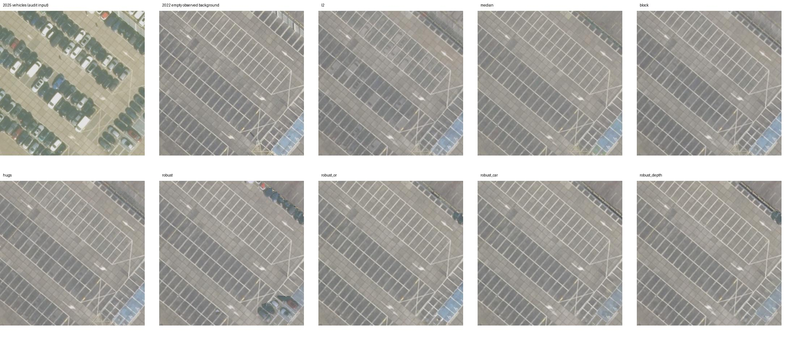
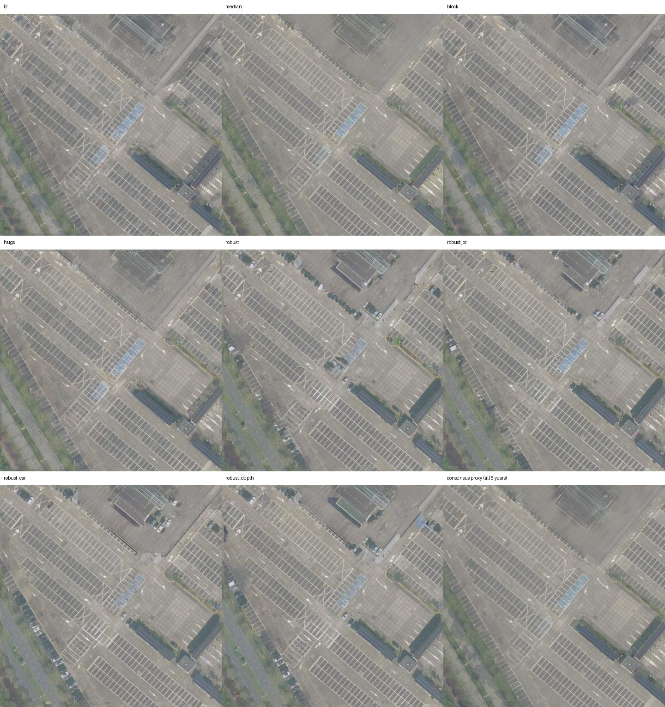

# 동적 차량 제거 S의 텍스처 베이킹 파일럿

2026-10-25 · 실제 실행 결과 · seed 42 · NVIDIA L40S-24Q

## 확인한 결과

차량이 보인 자리에 다른 연도의 빈 주차면이 있으면 **RobustNeRF형 S로 차량 잔상을 줄일 수 있었다.** 표시한 차량 16대 내부에서 빈 2022년 배경 대비 PSNR은 L2 **27.27 → 38.02 dB**로 10.75 dB 높아졌고, 차량 RGB에 더 가까운 픽셀 비율은 **1.6% → 0.3%**였다. 이 16개 영역은 보조 검증 표본이며, 장면 전체의 모든 차량이 제거됐다는 뜻은 아니다.

학습 기법 중 지면 전체 PSNR은 HuGS형 **32.45 dB**가 가장 높았고, 고정 Robust형은 **28.06 dB**였다. 차량 위치 표본의 배경 복원과 전체 지면 품질의 최선이 달랐다.

이 장면은 학습 5개 연도 중 4개에 빈 주차면이 많아 **단순 시간 중앙값도 강한 기준선**이다. 전체 품질과 차량 제거를 구분해서 볼 필요가 있다. 중앙값은 학습 정사영상에서 직접 계산했으므로 합성 카메라의 재표본화를 거치는 베이킹보다 유리하며, 평가 consensus도 중앙값으로 만들어 이 기준선에 유리하다. 논문 전체 NeRF의 우열을 판정한 결과는 아니다.

## 데이터와 공통 조건

- 최초 Jaarbeurs 후보(52.08718, 5.10243)는 2024년부터 공사장으로 바뀌어 제외했다. IKEA 후보는 건물·상시 주차 차량이 많았다. 최종 장면은 **Jaarbeurs 남쪽 주차장 (52.08235, 5.1009), 120×120m**이다.
- PDOK HR 2021–2025를 학습에, 2026을 시기 hold-out에 사용했다. 연도당 0°/20°/35°/45° 합성 카메라 4대, 768×576, 학습 20장이다. 정사사진을 지면 homography로 투영했으므로 실제 사선 촬영의 차량 입체감·건물 parallax는 없다. 연도는 레이어 이름이며 정확한 비행일은 확인하지 않았다.
- 2023 기준 SIFT/RANSAC 유사변환으로 정합했다. 2023 자체를 제외한 inlier 중앙 오차는 0.24–0.59px(원본 1500²)이며, 2025/2026은 inlier가 18/11개로 적어 지역별 잔여 오차 가능성이 있다. 학습 기준 연도로 강건한 채널별 노출 정규화를 하고, 베이킹 중에는 모든 학습 기법에 시점별 **3×3+bias 색보정**을 동일하게 학습했다.
- 출력 T는 **1024²**이고 공통 **512² bilinear 기저**에서 최적화했다. native 1024² 실험에서 확인된 고주파 바둑판 잔상을 줄이기 위한 공통 조건이다. 모든 학습 기법은 평균 텍스처 초기화, Adam 600회, batch 4, texture lr 0.025, color lr 0.001, 색보정 identity ridge 0.001을 사용했다. 기준 시점 2023/nadir 색보정은 고정했다. 추가 TV·생성형 inpainting은 사용하지 않았다.
- 지면 평가 ROI는 전체 텍스처의 50.7%이다. 지붕 등 평면 가정이 약한 구역을 피했다. 원본 전체 지표도 `metrics.csv`의 `*_full` 열에 있다.
- 2026 quick/정식은 바이트가 다르지만 영상 상관 0.975, 같은 metadata UUID이며 차량 배치가 유사했다. 독립 비행을 확인하지 못해 quick을 학습·consensus 모두에서 제외했다.

## S 구현과 원 기법에서 바꾼 부분

| S | 구현 및 명시적 차이 |
|---|---|
| L2 / Median | S≡1 / 정합된 학습 5년 RGB 채널별 중앙값. Median에는 최적화·학습 마스크가 없다. |
| Block형 | DOTA YOLO11s-OBB의 small/large vehicle, confidence 0.25, 최대 검출 1000, OBB polygon + 5×5 팽창. 각 합성 영상에 검출했다. 원 Panoptic-DeepLab을 대체했고, 포즈를 아니 COLMAP 마스킹은 생략했다. 차량 클래스는 주차 차량도 제거 대상으로 삼는다. 그림자 클래스는 없다. |
| HuGS형 | 20장 모든 쌍 SIFT, ratio 0.75, homography RANSAC 2px. 자기 영상 포함 5개 이상 영상의 지지를 정적 특징으로 삼았다(5/20=0.25). COLMAP 3D track을 평면의 검증된 2D 매칭 빈도로 대체했다. SAM ViT-B point prompt와 자동 분할, 공식 기본 64 points/side·crop 1·IoU 0.8·stability 0.9를 사용했다. 공식 기본값 T_CR=0.95, T_m=0.5를 적용하고 smooth 7/erode 5도 반영했다. warm-up은 공통 L2 600회이며 masked bake는 평균 초기화에서 별도 600회다. |
| Robust / 식 | 매 반복 영상별 valid 잔차 median → 3×3 평균≥0.5 → 16×16 문맥 평균≥0.6을 8×8 내부 타일에 적용. S는 stop-grad. 서베이의 게재본 식 해석을 따른다. |
| Robust / OR | 공식 MultiNeRF 코드처럼 저잔차·이웃 inlier·patch inlier를 OR로 합친다. 격자 타일·영상별 median이라는 베이킹용 차이는 유지한다. |
| Robust / car | 영상별 중앙 깊이 D에 대해 k=ceil(4.5m×480px/D), 내부 타일 floor(k/2). 3×3 단계는 동일하다. |
| Robust / depth | 픽셀별 k=ceil(4.5m×480px/depth), 8–64 제한, integral image로 가변 문맥 평균. 내부 결정 타일은 8×8로 고정한 제안 변형이다. 깊이별 타일 크기까지 바꾼 완전한 geometry-aware 설계는 아니다. |

HuGS는 공식 코드처럼 residual upper에 base를 합쳐 평균이 quantile보다 큰 경우를 허용하고, SAM 겹침을 작은 마스크 우선의 분리 영역으로 만든 뒤 정적 비율 0.5를 판정했다. 세 방법 모두 S를 베이킹에 이식한 것이며 원 논문 전체 파이프라인의 재현이라고 부르지 않는다.

## 결과 표

| 기법 | 차량 위치 표본 PSNR↑ | 차량 위치 표본 ghost↓ | 지면 PSNR↑ | 지면 SSIM↑ | 지면 LPIPS↓ |
|---|---:|---:|---:|---:|---:|
| L2 | 27.27 | 1.6% | 30.38 | 0.920 | 0.038 |
| Median (참고) | 35.69 | 1.1% | 37.57 | 0.974 | 0.013 |
| Block형 S | 31.56 | 1.2% | 30.85 | 0.934 | 0.033 |
| HuGS형 S | 32.81 | 0.3% | 32.45 | 0.931 | 0.032 |
| Robust / 식 | 38.02 | 0.3% | 28.06 | 0.882 | 0.062 |
| Robust / OR | 38.09 | 0.5% | 29.96 | 0.904 | 0.045 |
| Robust / car | 38.12 | 0.4% | 29.90 | 0.903 | 0.046 |
| Robust / depth | 37.78 | 0.5% | 29.03 | 0.896 | 0.053 |

차량 위치 표본 PSNR/ghost는 시각적으로 표시한 **16대 몸체 내부, 반경 5 texel 원**을 대상으로 하며 깨끗한 2022 관측을 비교 기준으로 삼았다. 표시는 이 실험을 수행한 에이전트가 했고 독립적인 사람 검수는 받지 않았다. ghost는 출력이 빈 배경보다 2025 차량 RGB에 가까운 픽셀 비율이다. 그림자·차량 외곽을 모두 포괄하는 제거율은 아니다.

지면 PSNR/SSIM은 정합·색 정규화한 HR 6년의 **픽셀별 중앙값 consensus**와 비교했다. ROI LPIPS는 ROI 밖을 consensus로 대체한 뒤 AlexNet LPIPS를 계산한 진단값이다. 표준 전체 LPIPS는 CSV에 별도로 기록했다.

| 기법 | 잔차 변화 영역 PSNR↑ | 변화 proxy 제외 P / R↑ | 2026 정적 PSNR↑ | 차량 검출 수↓* | 무지지 텍셀↓ |
|---|---:|---:|---:|---:|---:|
| L2 | 26.77 | 0.0% / 0.0% | 27.18 | 9 | 0.0% |
| Median (참고) | 34.78 | — / — | 29.12 | 0 | — |
| Block형 S | 27.52 | 31.8% / 34.9% | 27.30 | 0 | 0.0% |
| HuGS형 S | 29.27 | 37.5% / 52.3% | 27.90 | 0 | 0.0% |
| Robust / 식 | 24.17 | 14.0% / 89.7% | 26.81 | 18 | 0.2% |
| Robust / OR | 26.20 | 20.8% / 90.4% | 27.78 | 3 | 0.0% |
| Robust / car | 26.37 | 14.8% / 92.5% | 27.23 | 7 | 0.1% |
| Robust / depth | 25.34 | 14.5% / 90.5% | 27.21 | 11 | 0.2% |

변화 proxy는 어느 학습 연도에서든 consensus RGB RMS 차이가 0.12보다 큰 픽셀의 합집합으로 ROI의 28.2%이다. P/R은 S가 제외한 영역을 이 proxy와 비교한 것으로 **차량 semantic GT에 대한 precision/recall이 아니다**. 조명·그림자·정합 오차도 포함한다. 2026 정적 영역은 consensus와 RMS<0.06인 ROI의 74.3%이고, 표에는 추가 held-out 색 fitting 없는 PSNR을 사용했다. 별도 checkerboard 분할로 hold-out affine을 추정한 보조값도 CSV에 보존했다.

*차량 검출 수는 입력 마스킹과 같은 DOTA 검출기로 측정하므로 편향이 있다. **검출 0건은 차량 잔상 0을 뜻하지 않는다.** 무지지 텍셀은 최종 S의 어느 관측에도 지지받지 못한 ROI 비율이다. 이곳을 새 배경으로 채우지 않았고 공통 초기화/저차원 기저의 값이 남을 수 있다.

## 관찰과 적용 판단

- **차량**: 위 확대 그림에서 L2의 옅은 차량 흔적과 Robust 계열의 빈 주차면을 대조할 수 있다. Block/HuGS는 검출·분할 누락으로 일부 차량 흔적을 남긴다. 16대 내부의 2025 제외 recall은 Block 65.0%, HuGS 48.2%, Robust/식 100.0%였다. 이는 영상의 몸체 내부 표본에 한정한다.
- **그림자와 디테일**: 차량의 클래스 마스크만으로 그림자가 제거되지는 않는다. Robust 계열은 넓은 그림자를 제외할 수 있지만 차선·포장선 등 정적 디테일까지 과하게 제외하고, 관측 지지가 사라지는 부분도 있다. 정적 영역 품질과 차량 위치 표본 품질은 같은 순위를 보장하지 않는다.
- **크기·깊이 적응**: 이 한 장면·한 seed에서 고정 Robust보다 확실한 개선을 입증하지 못했다. 차량 위치 표본 PSNR은 고정 38.02, car 38.12, depth 37.78 dB다. 깊이 적응은 문맥만 바꾸고 타일은 고정했으며 실제 입체 차량의 원근 변화는 재현하지 않는다.
- **장기 주차와 구멍**: 검출 기준 학습 5년 모두 차량인 ROI는 0.00%여서, 계속 가려진 배경을 복원하는 능력은 검증하지 못했다. 단순 중앙값이 유리한 저점유 조건에서 수행한 파일럿이다.

차량 위치 표본의 배경 복원을 우선하면 Robust형 S, 이 장면의 전체 지면 품질을 우선하면 HuGS형 S가 다음 후보가 된다. 정적 디테일과 관측 coverage를 함께 제어해야 하며, 이 결과만으로 Block-NeRF/HuGS 원 방법의 열세나 depth-adaptive 설계의 우월성을 주장할 수 없다. 한 seed·한 최종 장면·합성 사선·consensus proxy·추가 전처리 비용이라는 한계가 있다.

## 검산·재현·출처

HuGS의 SAM 자동 분할·point prompt에는 추가 전처리 비용이 든다. `hugs_stats.json`의 영상별 실행 시간을 남겼고, 공통 L2 warm-up 600회도 추가 비용이다. 따라서 최종 masked bake 600회가 같다는 사실은 총 계산량이 같다는 뜻이 아니다.

투영 역변환 오차 최대 0.000119px, OpenCV 합성 입력과 differentiable renderer의 RMSE 8.3e-07, 가변 box 평균과 직접 계산의 최대 차이 0.000282를 확인했다. 모든 S의 shape·binary·finite·valid 영역 검사도 통과했다. 정합·카메라·체크섬·패키지·seed는 `results/provenance.json`, 재실행은 `README.md` 및 `run.sh`에 있다. SAM/SIFT 캐시는 L2 잔차와 분리하여 최종 기저의 warm-up 잔차로 HuGS 결정을 갱신했다.

이미지: © Beeldmateriaal Nederland, PDOK 제공, **CC BY 4.0**, 정합·노출 정규화·투영·베이킹으로 가공. [PDOK](https://www.pdok.nl/introductie/-/article/pdok-luchtfoto-rgb-open-) · [Beeldmateriaal Nederland / CC BY 4.0](https://www.beeldmateriaal.nl/dataroom)

기법 확인: [HuGS 공식 구현](https://github.com/cnhaox/NeRF-HuGS/blob/master/HuGS/generate_static_mask.py), [RobustNeRF 공식 구현](https://github.com/google-research/multinerf/blob/main/internal/robustnerf.py), [YOLO OBB](https://docs.ultralytics.com/tasks/obb/), [SAM](https://github.com/facebookresearch/segment-anything). 전달된 `S_oracle_survey.pdf` §7을 베이킹 손실 구성의 기준으로 삼았다.
