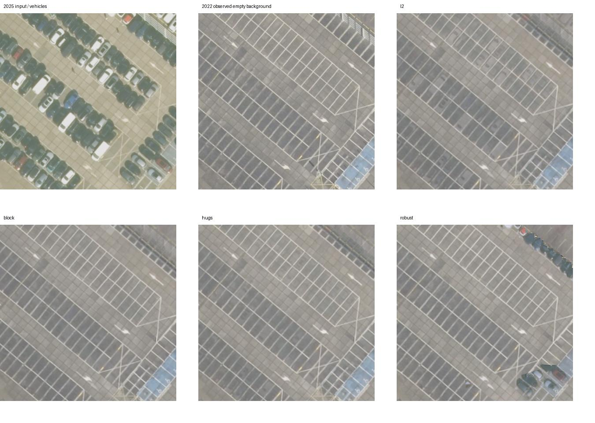

# 차량 제거 베이킹 파일럿 — 짧은 결과 보고

2026-10-25. **차량 위치 표본의 배경 복원은 Robust형 S, 학습 기법 중 지면 전체 품질은 HuGS형 S가 가장 좋았다. 시간 중앙값이 전체 품질에서는 모두 앞섰다.**

| S / 기준선 | 차량 위치 표본 PSNR↑ | 지면 PSNR↑ | 지면 SSIM↑ |
|---|---:|---:|---:|
| L2 | 27.27 | 30.38 | 0.920 |
| Block형 | 31.56 | 30.85 | 0.934 |
| HuGS형 | 32.81 | 32.45 | 0.931 |
| Robust형 / 식 | 38.02 | 28.06 | 0.882 |
| 시간 중앙값 | 35.69 | 37.57 | 0.974 |

차량 위치 표본 지표는 그림에서 시각적으로 표시한 16대의 몸체 내부(각 반경 5 texel)를 실제 빈 2022년 관측과 비교했다. 지면 지표는 색 정규화한 6년 중앙값 consensus에 대한 값이다. 단위는 PSNR dB. 표시는 에이전트가 수행했고 독립적인 사람 검수 라벨은 아니다.

- L2에는 옅은 차량 흔적이 남았고 세 S 모두 이 표본의 빈 배경 복원을 개선했다. Robust형은 차량 위치 표본 PSNR을 L2 대비 10.75dB 높였지만, 전체 지면에서는 더 낮은 품질을 보였다. 장면 전체의 모든 차량·그림자가 제거된 것은 아니다.
- Block형은 항공영상용 DOTA 검출기로 원 분할기를 대체했다. 검출 누락과 차량 그림자가 남는 한계가 있다. HuGS형은 평면 SIFT 매칭 빈도와 SAM을 결합했으며 일부 영상에서는 차량을 정적으로 받아들였다.
- 고정 Robust / car-scaled / depth-adaptive의 차량 위치 표본 PSNR은 각각 38.02 / 38.12 / 37.78dB였다. 한 장면·한 seed에서 크기·깊이 적응의 우월성을 확인하지 못했다.

**조건.** Jaarbeurs 원 후보는 2024년 이후 공사 때문에 제외하고 남쪽 주차장(52.08235, 5.1009)으로 옮겼다. PDOK HR 2021–2025, 연도당 합성 카메라 4대(총 20장)로 학습하고 2026을 hold-out으로 썼다. 모든 학습 기법은 평면 메쉬, 동일 seed·색보정·Adam 600회를 사용했다. 출력은 1024²이고 카메라 표본 밀도에 맞춘 공통 512² bilinear 기저에서 최적화했다. native 1024²에서 발견된 바둑판 잔상은 이 조건으로 줄였다.

**해석의 범위.** 빈 주차면이 학습 5년 중 4년에 많아 중앙값이 강한 장면이며, consensus 자체가 중앙값이어서 그 기준선에 유리하다. 실제 사선 촬영·원 기법 전체 NeRF·계속 가려진 배경의 복원은 검증하지 않았다. 검출 수 0을 제거 성공으로 보지 않았다. 전체 지표, S 마스크, 깊이·OR 변형, hold-out, 무지지 영역은 [상세 리포트](REPORT.md), [이미지 포함 HTML](REPORT.html), [지표 CSV](results/metrics.csv), [차량 표본 CSV](results/manual_metrics.csv)에 있다.

이미지 © Beeldmateriaal Nederland / PDOK, [CC BY 4.0](https://www.beeldmateriaal.nl/dataroom). 정합·색 정규화·투영·베이킹으로 가공했다.
