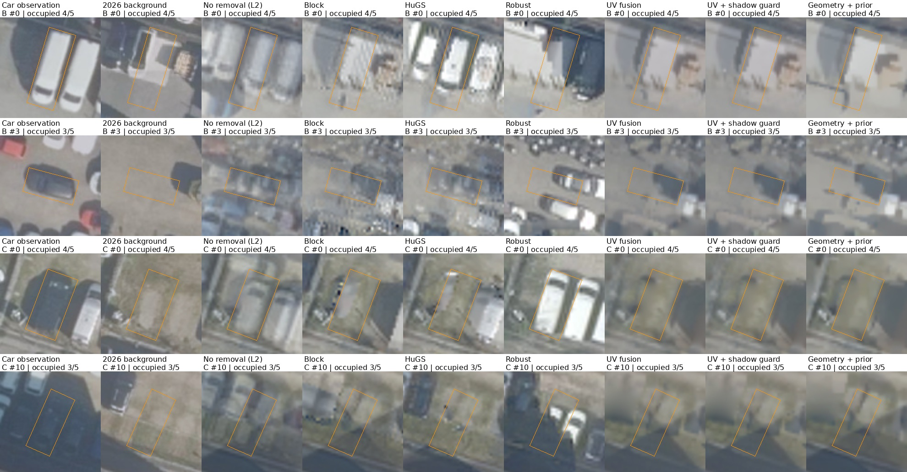
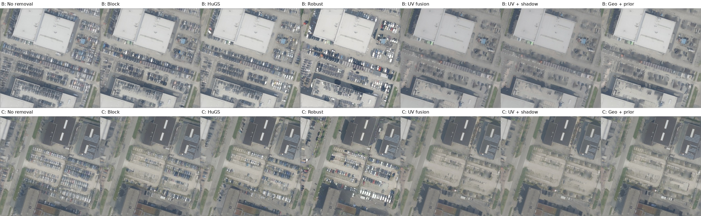

# 고점유 차량 제거: 개선 기준선 실험

실행일 2026-10-26. Intro → Method → Result. 기존 실험을 유지하고 개선안의 이득과 실패를 함께 비교했다.

## 1. Intro

차량이 5회 중 3~4회 보이면 단순 평균과 잔차 기반 이상치 제거가 차량을 배경으로 받아들일 수 있다. 이번 목표는 이 조건에서 배경 관측을 우선 이용하고, 관측이 없는 곳에는 공간 사전정보를 명시적으로 넣는 실용적인 베이킹 기준선을 시험하는 것이다. 원 논문의 NeRF 재현이 아니라 S를 바꾸는 평면 텍스처 베이킹이다.

### 이미지 출처와 데이터

PDOK 네덜란드 항공 정사영상(CC-BY), [공식 WMS](https://service.pdok.nl/hwh/luchtfotorgb/wms/v1_0). `2021_orthoHR`~`2026_orthoHR`, 120m × 120m, 요청 1500 × 1500px. B 중심은 (52.0740, 5.0460), C 중심은 (52.0773, 5.04895). 실제 연도별 사진이며 차량을 합성해 넣지 않았다. 정확한 요청 URL·체크섬은 [원본 manifest](../candidates/source_manifest.json)에 있다. 요청 확장자는 PNG지만 일부 응답의 실제 인코딩은 JPEG다.

2021–2025만 학습에 사용하고 2026은 평가의 실제 배경 관측으로 사용했다. 학습 차량 마스크 면적은 B 약49–59%, C 약46–55%다. 차량 검출 경험 픽셀 중 3년 이상 점유한 비율은 각각68.1%,63.0%다. 이전 쉬운 장면의 해당 비율은0%였다.

## 2. Method

### 공통 베이킹 프로세스와 L2

1. 지리 좌표로 내려받은 연도별 영상을 LK 특징 추적과 RANSAC으로 미세 정합하고 공통 색 좌표로 정규화한다. 동일한 전처리 결과를 모든 방법이 공유한다.
2. 지면 평면을 메쉬 M으로 둔다. 각 학습 연도의 정사영상을 homography로 기울기0/20/35/45도인 사선 카메라4개에 투영해 총20개 입력을 만든다. 이는 실제 사선 촬영이 아닌 반합성 입력이다.
3. 텍스처 T를 `grid_sample`로 카메라에 렌더한다. 출력은1024², 최적화 파라미터는 공통512² 격자다. 학습 가능한 카메라별3×3색변환+bias를 사용하며2023년 nadir를 고정한다.
4. 기본 손실은 `Σ S × RGB제곱오차 / 유효픽셀수 + 색변환 정규화`다. **L2는 픽셀 RGB 차이를 제곱해 더하는 손실**이다. 여기서 **no-removal=L2, S=1**이므로 차량 픽셀도 그대로 목표로 삼는다. 차가 여러 해에 많으면 그 색이 텍스처에 남는다.
5. 학습형 방법은 모두 Adam600업데이트, batch4, 텍스처lr0.025, 색lr0.001, 색정규화0.001, seed42/43/44를 사용했다. 학습 초기 텍스처는 개선안에 명시한 경우만 바꿨다.

기존 Block형은 DOTA YOLO11s-OBB 차량 검출을 각 사선 이미지에 적용해 S를 만든다. HuGS형은 SIFT 일관성과 L2 잔차 및 SAM을 결합한다. Robust형은 잔차 중앙값과 공간 문맥으로 S를 반복 갱신한다. 차량 다수 관측, 검출 누락, 빈 관측 부족은 세 방법 모두의 한계다. 원 논문의 panoptic 모델·NeRF 전체 학습을 그대로 재현한 것은 아니다.

### 개선안과 분리 실험

- **UV fusion**: 원본 정사영상에서 검출한 차량 마스크를 공통 UV에 둔다. 각 texel에서 차량으로 검출되지 않은 학습 관측만 RGB 채널별 median으로 합친다. 5회 모두 가린 곳은 최근접 초기값 뒤4이웃 조화 보간256회로 메운다. 관측값은 보간 중 고정한다. 공통512² 표현을 거쳐1024²로 출력한다. 이미 평면 UV가 알려진 경우의 직접 텍스처 추정 기준선이며, 별도600회 최적화는 하지 않는다.
- **UV + shadow guard**: 위 방식에서 차량 근처18texel 이내이고,61×61 비차량 주변 평균 밝기의0.72미만인 픽셀도 제외한다. 그림자 정답 분할이 아닌 단순 밝기 휴리스틱이다. 같은 조화 보간을 사용한다.
- **Geometry mask**: 원본 연도 차량 마스크를 알려진 homography로 네 카메라에 투영한다. 보간값>0.05를 제외한다. 시점마다 독립 검출하는 오류를 줄이되 기존 평균 초기값을 유지한다.
- **Geometry + init**: 위 마스크와 UV fusion 초기값으로 동일한600회 베이킹을 한다.
- **Geometry + prior**: 위 설정에 관측이 적은 곳일수록 강한 TV와, 완전 미관측 영역의 초기값 anchor를 추가한다. `L=Ldata+Lcolor+0.01 LTV+0.05 Lanchor`; TV 가중치는512격자에서 `1/(1+배경관측수)`다. anchor는 면적 리샘플링한 관측비율<0.01에 적용한다. 공간적으로 매끄러운 배경을 선호하므로 차선도 흐려질 수 있다.

[기본 프로토콜](protocol.json), [그림자 변형 프로토콜](shadow_protocol.json)에 계수를 기록했다. 학습·fusion은2021–2025의 이미지와 마스크만 사용한다. 이전 결과를 보고 설계한 **동일 벤치마크의 탐색적 후속 실험**이며 외부 미관측 데이터 일반화 검증은 아니다. 그림자 변형은 첫 개선 결과에 남은 어두운 흔적을 보고 추가했으며 임계값 탐색은 하지 않았다. 모든 변형을 아래에 보고한다.

### 평가

이전 실험의 고정된 차량 전체 OBB33개(B16,C17)를 그대로 사용한다. 그중 학습5회 중3~4회 차량에 가려진21개(B4,C17)가 주 평가다. 점유는 OBB의55%이상이 DOTA 차량 마스크와 겹치는 연도 수인 대리 지표다. **“차량 내부”라는 작은 중심 픽셀 평가가 아니라 차량 전체 위치의 폴리곤**이다.

PSNR은2026년에 실제 관측한 배경과의 오차다. LPIPS는33개 전체 OBB의80×80 crop에서 폴리곤 바깥을 정답으로 채워 비교한다. 정적 PSNR은 학습 중 검출차량이 없고 색변화가 적으며2026에도 검출차량이 없는 대조영역이다. PSNR↑, LPIPS↓가 좋다. 배경 자체의 연도별 변화·그림자·정합오차가 남으므로 완벽한 정적 GT가 아니다. 검출기 기반 평가 위치·점유는 같은 검출기를 쓰는 방법에 유리할 수 있다.

## 3. Result

| 방법 | B: 차량 위치 PSNR ↑ | C: 차량 위치 PSNR ↑ | B / C LPIPS ↓ | B / C 정적 PSNR ↑ |
|---|---:|---:|---:|---:|
| No removal (L2) | 19.01 ± 0.18 | 18.69 ± 0.24 | 0.149 / 0.338 | 21.97 / 24.40 |
| Block | 19.94 ± 0.21 | 20.98 ± 0.19 | 0.136 / 0.165 | 21.85 / 24.80 |
| HuGS | 18.16 ± 0.10 | 20.89 ± 0.09 | 0.127 / 0.176 | 21.01 / 24.33 |
| Robust | 14.49 ± 0.36 | 16.00 ± 0.40 | 0.173 / 0.342 | 19.71 / 23.83 |
| UV fusion | 20.81 | 22.10 | 0.085 / 0.146 | 24.51 / 26.62 |
| UV + shadow guard | 21.00 | 22.23 | 0.079 / 0.130 | 24.58 / 26.47 |
| Geometry mask | 19.95 ± 0.15 | 20.86 ± 0.09 | 0.118 / 0.183 | 21.68 / 24.89 |
| Geometry + init | 19.94 ± 0.17 | 21.33 ± 0.10 | 0.118 / 0.178 | 21.68 / 24.90 |
| Geometry + prior | 20.39 ± 0.23 | 21.74 ± 0.11 | 0.114 / 0.170 | 21.83 / 25.08 |

학습형은3seed의 평균±표본표준편차(PSNR), 다른 열은 평균이다. 직접 UV fusion 두 방법은 결정적 계산1회라 표준편차가 없다. 직접 fusion과600회 최적화는 계산 방식과 비용이 다르며 동일 반복 수의 알고리즘 경쟁으로 해석하면 안 된다.

### 정성 비교

첫 두 열은 차량이 있던 학습 관측과2026년 실제 배경이다. 주황선은 점수를 계산한 고정 OBB이며 시각화에만 그렸다. B #0/#3, C #0/#10은 기존 보고서와 동일한 위치다. 모든 방법은 seed42, 동일 crop과 색 범위를 사용한다. 폴리곤 밖 인접 차량은 해당 위치 점수에 포함되지 않는다.

### 해석과 남은 실패

배경만 모으는 UV fusion이 기존 Block/HuGS/Robust형보다 두 장면 모두 높은 주평가 PSNR을 얻었다. 차량이 없는 관측이 소수여도 의미 마스크가 그 관측을 골라주므로 다수결 잔차 선택보다 유리하다. 공통 UV가 주어진 평면에서는 다시 역렌더링 최적화하는 것보다 직접 합성이 효과적이었다.

Geometry mask만으로는 큰 개선이 없었다. 초기값 변경의 효과도600회 데이터 적합 뒤 상당 부분 사라졌다. 공간 prior는 Geometry + init보다 PSNR을 높였지만 직접 fusion에는 미치지 못했다. 따라서 **현재 조건의 우선 추천은 UV fusion, 그림자 제거가 필요하면 고정 shadow guard를 추가하는 기준선**이다.

차량 밝은 차체와 중첩 흔적은 줄었지만 일부 어두운 흔적·검출 누락 차량·주변 그림자는 남는다. shadow guard는 진짜 어두운 포장·표식도 제외할 수 있다. 5회 모두 차량이 가린 영역의 값은 복원이 아니라 공간 보간 추정이며 차선·작은 디테일을 지울 수 있다. 모든 차량이 완전히 사라졌다는 결론은 아니다. 실제3D 메쉬와 사선 사진의 parallax가 있는 상황에 직접 일반화할 수 없다.

### 파일과 재현

- [전체54행 비교 CSV](results/combined_metrics.csv), [신규22행 CSV](results/metrics.csv), [위치별 신규 지표](results/object_metrics.csv)
- [검증 결과](results/validation.json): 관측 median 보존, 마스크·출력 유효성,18개600업데이트 실행, 기존 L2 점수 동일 재계산 확인.
- `scenes/{industrial_b,industrial_c}/results/textures/`: seed42 최종 텍스처와 결정적fusion. `seeds/{43,44}/textures/`: 반복 실험.
- `train.py` → `shadow_guard.py` → `evaluate.py` → `validate.py` → `make_report.py`. 프로젝트 `.venv/bin/python`으로 실행한다. 원본 장면·정합·모델 마스크는 상위 실험 산출물을 재사용한다.
- [기존 어려운 데이터셋 전체 과정](../PROJECT.md), [첫 쉬운 장면 실험](../../PROJECT_EASY_PILOT.md)
