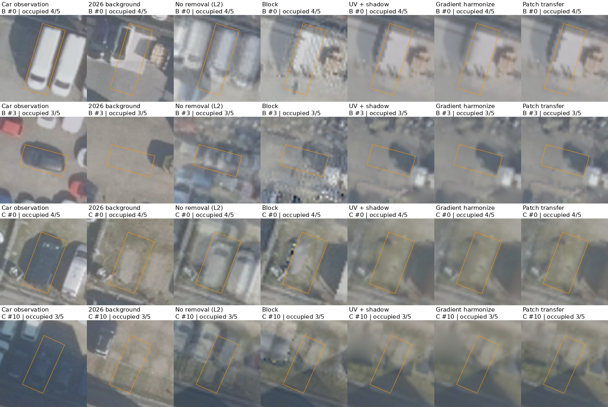
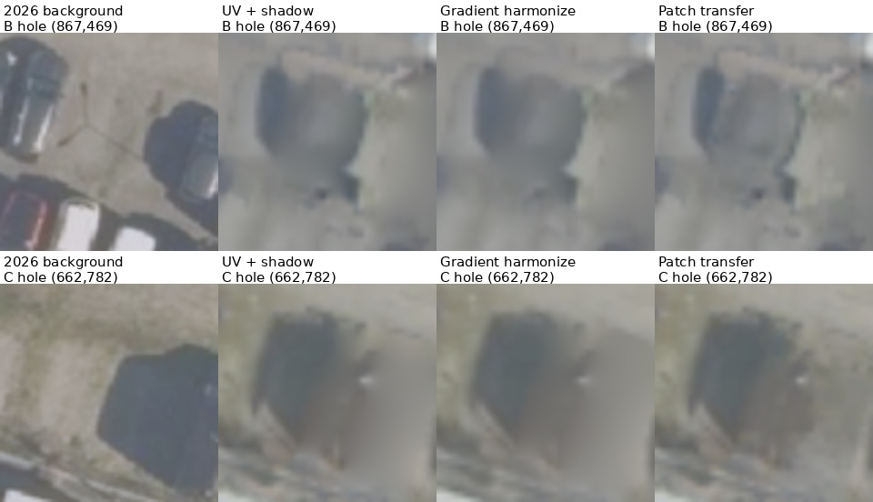
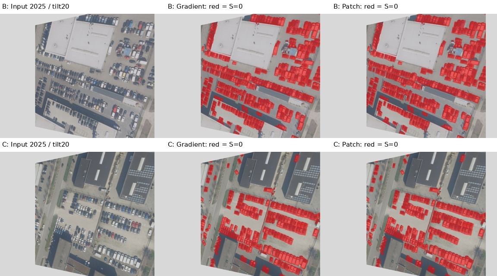

# 부자연스러운 채움 개선 추가 기준선

같은 S=shadow guard를 유지한 gradient-domain 조화 및 주변 패치 전사. 학습2021–2025만 사용, 평가2026. 고정33OBB 및주요21OBB 재사용.

| 방법 | B 차량 PSNR | C 차량 PSNR | B/C LPIPS | B/C 정적 PSNR |
|---|---:|---:|---:|---:|
| No removal (L2) | 19.01 ± 0.18 | 18.69 ± 0.24 | 0.149 / 0.338 | 21.97 / 24.40 |
| Block | 19.94 ± 0.21 | 20.98 ± 0.19 | 0.136 / 0.165 | 21.85 / 24.80 |
| UV fusion | 20.81 | 22.10 | 0.085 / 0.146 | 24.51 / 26.62 |
| UV + shadow guard | 21.00 | 22.23 | 0.079 / 0.130 | 24.58 / 26.47 |
| Gradient harmonize | 20.82 | 22.32 | 0.077 / 0.125 | 24.62 / 26.56 |
| Patch transfer | 21.00 | 22.15 | 0.077 / 0.129 | 24.58 / 26.47 |

고정 계수는protocol.json, 실제미충전/수렴/시간은scenes/*/results/*_trace.json, 전체CSV는results/combined_metrics.csv. 관측되지 않은 배경을 정확히복원한 것은 아니며 일부지표가 악화될수있다.
