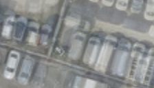

## 1. L2 — 모든 관측을 그대로 맞추기

**한 문장으로:** 차량과 바닥을 구분하지 않고, 모든 사진의 색을 하나의 Texture로 최대한 설명한다.

### 예를 들면

같은 주차면이 다섯 장 중 두 장에서는 빈 바닥, 세 장에서는 흰 차로 보인다고 하자. 바닥색과 차 색을 모두 맞추려다 중간색이나 흐릿한 차량 흔적이 남을 수 있다.

### 어떻게 작동하나

1. Texture를 현재 카메라에서 보았을 때의 예측 이미지를 만든다.
2. 예측과 입력 사진의 RGB 색 차이를 제곱해 손실로 계산한다. 모든 유효 픽셀의 S는 1이다.
3. 손실이 작아지도록 Texture와 카메라별 색보정을 600회 업데이트한다.

### 이번 파일럿에서 실제로 한 일

공통 평면 투영, 평균 초기값, 512² Texture 파라미터와 1024² 출력을 사용한 L2 baking. 별도의 차량 마스크가 없다.

### 결과와 해석

차량 위치 PSNR: **B 19.01 ± 0.18 dB / C 18.69 ± 0.24 dB**.

차량 제거 기능을 넣지 않았을 때의 출발점이다. 다른 방법이 이보다 좋아지는지 확인하는 기준이며, 비교 대상에서 빼면 개선 효과를 판단하기 어렵다.

### 무엇을 조심해야 하나

관측의 다수가 차량이어도 그대로 학습한다. 단일 위치의 단순화된 문제에서는 평균색이 해이지만, 실제 결과에는 투영·보간·색보정도 영향을 준다.

| 차량이 있는 입력 | 최종 Texture | 실제 빈 배경(2026) |
|---|---|---|
|  |  |  |

사진은 C의 첫 고정 평가 OBB 주변을 동일 범위로 자른 결과다. 인접 차량·그림자는 평가 폴리곤 밖일 수 있으며, 화면 전체가 해당 PSNR의 평가 영역이라는 뜻은 아니다.

