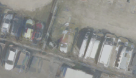

## 2. Temporal median — 중간값으로 합치기

**한 문장으로:** 같은 위치를 찍은 여러 사진에서, 색의 평균 대신 채널별 중간값을 고른다.

### 예를 들면

다섯 사진에서 바닥이 네 번, 차가 한 번 보이면 특이한 차량 색의 영향을 줄이기 쉽다. 반대로 차가 세 번 이상 보이면 중간값도 차 쪽 색을 선택할 수 있다.

### 어떻게 작동하나

1. 정합된 다섯 학습 연도에서 같은 지면 위치의 RGB 값을 모은다.
2. R·G·B 각각에서 중앙값을 계산해 Texture를 직접 만든다.
3. 카메라로 다시 렌더링하며 Texture를 최적화하는 600회 학습은 하지 않는다.

### 이번 파일럿에서 실제로 한 일

학습 2021–2025의 채널별 중앙값을 사용한 결정적 1회 계산. 기존 중앙값 기준선은 학습형 방법의 512² 파라미터 제약을 거치지 않으므로 표현 조건도 완전히 같지는 않다.

### 결과와 해석

차량 위치 PSNR: **B 18.48 dB / C 18.85 dB**.

복잡한 모델 없이도 다중 시기 영상만으로 어느 정도 차량 흔적을 줄일 수 있는지 보는 직접 합성 기준선이다.

### 무엇을 조심해야 하나

차량을 이해하고 제외하는 방법이 아니다. 빈 배경이 소수인 고점유 주차장에서는 다수 차량색을 배경처럼 선택할 수 있다.

| 차량이 있는 입력 | 최종 Texture | 실제 빈 배경(2026) |
|---|---|---|
|  |  |  |

사진은 C의 첫 고정 평가 OBB 주변을 동일 범위로 자른 결과다. 인접 차량·그림자는 평가 폴리곤 밖일 수 있으며, 화면 전체가 해당 PSNR의 평가 영역이라는 뜻은 아니다.

