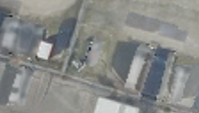

## 3. Block-NeRF형 — 차량으로 검출된 픽셀은 제외하기

**한 문장으로:** 먼저 “여기는 차량”이라는 마스크를 만들고, 그 부분은 바닥 Texture를 학습시키지 않는다.

### 예를 들면

2021년에는 차가 있고 2022년에는 바닥이 보인다면, 2021년 차량 픽셀을 제외하고 2022년 바닥 관측을 사용한다. 몇 년 동안 차가 자주 보였는지보다 검출이 맞았는지가 중요하다.

### 어떻게 작동하나

1. 각 합성 카메라 입력에서 차량 검출기로 차량의 회전 사각형 영역을 찾는다.
2. 영역을 조금 넓혀 차량 경계까지 제외한다. 제외 마스크를 D라 하면 S=1−D이다.
3. 남겨진 관측으로 동일한 600회 baking을 수행한다.

### 이번 파일럿에서 실제로 한 일

원 Block-NeRF의 semantic 제외 아이디어만 차용했다. 원래 분할기 대신 DOTA YOLO11s-OBB를 사용하고 차량 영역에 5×5 팽창을 적용했다. 전체 Block-NeRF 재현이 아니다.

### 결과와 해석

차량 위치 PSNR: **B 19.94 ± 0.21 dB / C 20.98 ± 0.19 dB**.

두 장면의 차량 위치 PSNR이 L2보다 높았다. 차량이라는 종류를 직접 찾는 정보가 반복 차량의 영향도 줄일 수 있음을 보여준다.

### 무엇을 조심해야 하나

검출하지 못한 차량은 남는다. 사각형 밖의 그림자는 놓칠 수 있고, 사각형 안에 섞인 바닥은 함께 제외한다. 검출기 기반 평가 위치는 같은 검출기를 쓰는 방법에 유리할 가능성도 있다.

| 차량이 있는 입력 | 최종 Texture | 실제 빈 배경(2026) |
|---|---|---|
|  |  |  |

사진은 C의 첫 고정 평가 OBB 주변을 동일 범위로 자른 결과다. 인접 차량·그림자는 평가 폴리곤 밖일 수 있으며, 화면 전체가 해당 PSNR의 평가 영역이라는 뜻은 아니다.

