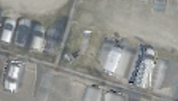

## 4. NeRF-HuGS형 — 정적 근거를 모아 영역별로 투표하기

**한 문장으로:** 여러 영상에서 반복 확인되거나 예측과 잘 맞는 픽셀을 정적 후보로 보고, SAM 영역마다 후보가 절반 이상이면 채택한다.

### 예를 들면

SAM이 나눈 한 바닥 영역에서 16개 픽셀 중 12개가 정적 후보라면 75%이므로 영역을 채택한다. 다른 영역은 4개만 후보라면 25%이므로 제외한다. 이 숫자는 이해용 예시이며 실제 실험 통계가 아니다.

### 어떻게 작동하나

1. 여러 영상에 걸쳐 같은 위치로 대응되는 특징점을 찾고, 그 점 주변을 SAM으로 확장해 정적 근거를 만든다.
2. L2 warm-up의 예측과 색이 잘 맞는 픽셀도 정적 근거로 추가한다. 두 근거를 합치되 큰 오차와 주변 일관성으로 보정한다.
3. SAM으로 나눈 각 영역에서 정적 후보 비율을 계산한다. 50% 이상인 영역을 채택하고, 마지막에 경계를 조금 축소한다.

### 이번 파일럿에서 실제로 한 일

실제 3D SfM track 대신 평면 SIFT 매칭의 영상별 지지 횟수를 사용했다. 자기 영상을 포함해 5개 이상 영상에서 지지된 점을 사용한다. 공통 L2 600회 warm-up으로 마스크를 만든 뒤, 평균 초기값에서 다시 600회 baking했다.

### 결과와 해석

차량 위치 PSNR: **B 18.16 ± 0.10 dB / C 20.89 ± 0.09 dB**.

픽셀 하나씩 들쭉날쭉 판정하는 대신 영역 단위로 판정을 정리한다. 다만 B에서는 L2보다 낮고 C에서는 높아, 영역 단위 처리가 모든 장면에서 개선을 보장하지 않았다.

### 무엇을 조심해야 하나

SAM은 영역을 나누는 도구이지 자동으로 “차량은 제외”라고 판단하는 정답 장치가 아니다. 반복 차량이나 잘못된 정적 후보도 영역 전체의 채택으로 이어질 수 있다.

| 차량이 있는 입력 | 최종 Texture | 실제 빈 배경(2026) |
|---|---|---|
|  |  |  |

사진은 C의 첫 고정 평가 OBB 주변을 동일 범위로 자른 결과다. 인접 차량·그림자는 평가 폴리곤 밖일 수 있으며, 화면 전체가 해당 PSNR의 평가 영역이라는 뜻은 아니다.

**SAM을 쓰는 다른 방법과의 차이:** HuGS형은 정적 후보가 **50% 이상이면 채택**, SAM-region vote는 큰 잔차 후보가 **40% 초과면 제외**한다. 후보를 만드는 근거도 다르므로 같은 방법으로 볼 수 없다.

