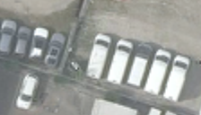

## 5. RobustNeRF형 — 예측과 안 맞는 관측을 이상치로 보기

**한 문장으로:** 차량 검출기 대신, 현재 Texture로 설명하기 어려운 관측의 영향을 줄인다.

### 예를 들면

대부분 바닥인 위치에 한 번만 빨간 차가 나타나면, 바닥 예측과 차 사진의 차이가 커져 차를 제외하기 쉽다. 반대로 계속 주차된 차는 예측에 흡수되어 오차가 작아질 수 있다.

### 어떻게 작동하나

1. 현재 예측 이미지와 입력 이미지의 잔차, 즉 색 차이의 크기를 계산한다.
2. 영상의 잔차 중앙값과 주변 픽셀·패치의 일관성으로 채택 마스크를 만든다.
3. 이 마스크를 사용해 Texture를 갱신하고, 다음 반복에서 잔차와 마스크를 다시 계산한다.

### 이번 파일럿에서 실제로 한 일

공식 RobustNeRF의 잔차·공간 문맥 기반 선택을 평면 baking에 옮긴 변형이다. 이 계열은 매 반복 S를 갱신하지만, 새 DINO 실험은 고정 warm-up에서 만든 S를 사용한다는 차이가 있다.

### 결과와 해석

차량 위치 PSNR: **B 14.49 ± 0.36 dB / C 16.00 ± 0.40 dB**.

이번 고점유 B/C에서는 차량 위치 PSNR이 L2보다 낮았다. 반복 차량이 많은 조건에서 “오차가 작다”는 근거만으로 빈 배경을 고르기 어려웠다.

### 무엇을 조심해야 하나

큰 오차는 차량뿐 아니라 정합오차·조명·그림자·아직 학습되지 않은 바닥 무늬에서도 발생한다. 작은 오차도 반드시 배경이라는 뜻은 아니다.

| 차량이 있는 입력 | 최종 Texture | 실제 빈 배경(2026) |
|---|---|---|
|  |  |  |

사진은 C의 첫 고정 평가 OBB 주변을 동일 범위로 자른 결과다. 인접 차량·그림자는 평가 폴리곤 밖일 수 있으며, 화면 전체가 해당 PSNR의 평가 영역이라는 뜻은 아니다.

원 논문 연결: [RobustNeRF](https://arxiv.org/abs/2302.00833). 원 논문 전체 성능과 위 파일럿 수치를 구분해야 한다.

