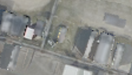

## 6. Geometry mask — 같은 차량 마스크를 여러 시점이 공유하기

**한 문장으로:** 시점마다 차량을 다시 검출하지 않고, 원본 사진의 차량 마스크를 카메라에 맞춰 옮겨 쓴다.

### 예를 들면

같은 2021년 사진에서 만든 네 가상 시점은 동일한 차량을 보고 있다. 각 시점에서 따로 검출해 하나는 찾고 하나는 놓치기보다, 원본의 한 검출 결과를 네 시점이 공유하게 한다.

### 어떻게 작동하나

1. 원본 정사영상에서 연도별 차량 마스크를 만든다.
2. 알려진 평면 좌표 대응으로 마스크를 각 가상 카메라에 투영한다.
3. 투영된 차량 영역을 제외하고, 평균 초기값에서 600회 baking한다.

### 이번 파일럿에서 실제로 한 일

투영된 마스크 보간값이 0.05보다 크면 제외했다. 실제 3D mesh의 visibility를 계산한 방법이 아니라, 알려진 평면 투영을 이용한 마스크 공유다.

### 결과와 해석

차량 위치 PSNR: **B 19.95 ± 0.15 dB / C 20.86 ± 0.09 dB**.

B/C 점수는 Block형과 비슷한 범위였다. 마스크를 시점 간 일관되게 만드는 것만으로 큰 추가 개선이 생기지는 않았다.

### 무엇을 조심해야 하나

원본 검출이 틀리면 여러 시점이 같은 오류를 공유한다. 실제 3D 표면의 가림과 높이 차이는 평면 homography만으로 처리할 수 없다.

| 차량이 있는 입력 | 최종 Texture | 실제 빈 배경(2026) |
|---|---|---|
|  |  |  |

사진은 C의 첫 고정 평가 OBB 주변을 동일 범위로 자른 결과다. 인접 차량·그림자는 평가 폴리곤 밖일 수 있으며, 화면 전체가 해당 PSNR의 평가 영역이라는 뜻은 아니다.

