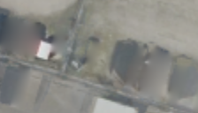

## 7. UV fusion — 차량 없는 사진의 바닥만 직접 모으기

**한 문장으로:** 같은 바닥 위치에서 차량이 없다고 검출된 연도만 모아, 최종 Texture를 직접 합성한다.

### 예를 들면

다섯 해 중 네 해는 차가 있고 한 해만 바닥이 보여도, 차량 마스크가 정확하면 그 한 번의 바닥 관측을 사용할 수 있다. 다수 관측을 따르는 중앙값과 다른 점이다.

### 어떻게 작동하나

1. 같은 지면 위치에 대응하는 다섯 연도의 색과 차량 마스크를 모은다.
2. 차량으로 검출된 연도를 빼고, 남은 관측의 채널별 중앙값을 사용한다.
3. 한 번도 바닥이 관측되지 않은 위치만 주변 값으로 보간하고, 공통 512² 표현을 거쳐 1024²로 출력한다.

### 이번 파일럿에서 실제로 한 일

관측이 없는 위치는 최근접값으로 초기화한 후 4이웃 조화 보간 256회로 채웠다. 관측된 값은 보간 중 고정했다. 별도의 600회 baking 최적화는 하지 않는다.

### 자세히 이해하기: 배경을 가져오는 것과 구멍을 채우는 것은 다르다

UV를 **주차장 바닥을 위에서 내려다본 한 장의 지도**라고 생각하면 된다. 지도상의 각 위치에 최종 바닥색을 하나씩 정한다. 이 설명의 연도별 차량·색 값은 원리를 설명하기 위한 예시이며 실제 표본의 측정값은 아니다.

#### 1. 같은 바닥 위치에서 사용할 관측만 고른다

주차면 가운데의 아주 작은 바닥 한 점을 선택하자. 사진들을 정합했기 때문에 각 연도 사진에서 그 점에 대응하는 위치를 찾을 수 있다.

| 연도 | 그 위치에서 보이는 것 | 차량 검출 | 처리 |
|---|---|---|---|
| 2021 | 흰 차 | 차량 | 제외 |
| 2022 | 빨간 차 | 차량 | 제외 |
| 2023 | 빈 아스팔트 | 비차량 | **사용** |
| 2024 | 흰 차 | 차량 | 제외 |
| 2025 | 검은 차 | 차량 | 제외 |

이 위치에서는 **2023년 사진의 색을 최종 Texture에 넣는다.** 차량이 네 번 보였어도, 그 네 관측을 먼저 제외했기 때문에 한 번 보인 바닥을 사용할 수 있다.

일반적인 시간 중앙값은 차량 여부를 구분하지 않고 다섯 관측을 모두 사용한다. 그래서 차량이 다수이면 차량 쪽 색을 선택할 수 있다. UV fusion의 차이는 **중앙값을 계산하기 전에 차량 관측을 제외한다**는 것이다.

여기서 “차량으로 검출된 연도를 뺀다”는 말은 **그 연도 사진 전체를 버린다는 뜻이 아니다. 해당 바닥 위치에서 차량으로 표시된 관측만 제외한다.** 같은 사진의 다른 위치에서 바닥이 보인다면 그 색은 사용할 수 있다.

#### 2. 빈 바닥이 여러 번 보였다면, 그 관측끼리 중앙값을 구한다

같은 위치의 바닥이 세 번 관측되었고 RGB 값이 다음과 같다고 하자.

```text
2021년 바닥색 : (100, 103, 106)
2023년 바닥색 : (110, 113, 116)
2025년 바닥색 : (105, 108, 111)
```

R·G·B 각각의 중앙값을 취하면 최종 색은 `(105, 108, 111)`이 된다. 전체 관측의 중앙값이 아니라 **차량을 제외하고 남은 관측의 중앙값**이다. 남은 관측이 하나뿐이면 그 관측의 색을 그대로 사용한다.

실제로는 “진짜 빈 바닥”을 완벽히 아는 것이 아니라 **검출기가 차량이라고 표시하지 않은 관측**을 사용한다. 따라서 검출하지 못한 차량이나 마스크 밖의 그림자는 여전히 섞일 수 있다.

#### 3. 모든 연도에서 차량이 있었다면 그 위치는 구멍이다

```text
차량 / 차량 / 차량 / 차량 / 차량
                 ↓
      사용할 수 있는 배경 관측 0개
                 ↓
          합성 Texture의 구멍
```

이 위치는 사진에서 가져올 바닥색이 없다. 이 구멍에만 **최근접 초기화 + 4이웃 조화 보간**을 적용했다.

1. **최근접 초기화:** 색이 정해진 위치 중 가장 가까운 곳의 색을 구멍에 일단 복사한다.
2. **4이웃 보간:** 구멍 안 각 픽셀의 색을 위·아래·왼쪽·오른쪽 색의 평균으로 갱신한다.
3. 이 갱신을 **256회 반복**해 구멍 안의 색이 주변과 부드럽게 이어지게 한다. 사진에서 가져온 관측 위치의 값은 이 보간 동안 고정한다.

한 채널의 값만 간단히 예를 들면 다음과 같다.

```text
            위: 100
왼쪽: 100      ?      오른쪽: 120
            아래: 120

새 값 = (100 + 100 + 120 + 120) / 4 = 110
```

실제 RGB 색에서는 세 채널 각각에 같은 계산을 적용한다. 주변에도 구멍 픽셀이 있으면 그 픽셀의 현재 값을 사용하므로 반복하면서 값이 전달된다. 256회는 이번 구현에서 정한 반복 횟수이며, 모든 크기의 구멍에서 완전히 수렴했다는 뜻은 아니다.

이것은 **가려진 바닥을 알아낸 것이 아니라, 주변과 비슷한 바닥일 것이라고 추정해 채운 것**이다. 구멍 아래에 차선이 있었다면 그 차선을 정확히 되살릴 근거가 없다.

#### 4. 512² → 1024²는 새로운 배경을 찾는 단계가 아니다

앞 단계의 1024×1024 합성 이미지를 다음처럼 처리했다.

```text
배경 관측 합성 + 구멍 채움 (1024×1024)
                  ↓
          512×512로 리샘플링
                  ↓
  bilinear 보간으로 1024×1024 최종 출력
```

다른 학습형 방법들이 512×512 Texture 파라미터에서 1024×1024 출력을 만들었기 때문에 UV fusion도 그 표현을 거치게 한 것이다. **이 과정에서 새로운 배경 정보는 생기지 않으며 작은 디테일이 흐려질 수 있다.** 표현을 맞춘 것이지 계산 방식·비용까지 같게 만든 것은 아니다.

앞에서 “관측된 값은 고정했다”고 한 것은 **구멍을 보간하는 동안**의 설명이다. 마지막 해상도 변환에서는 관측된 위치의 색도 조금 달라질 수 있다.

#### 5. 보간 256회와 baking 학습 600회는 다른 계산이다

| 구분 | 무엇을 하는가? |
|---|---|
| 학습형 baking 600회 | 현재 Texture를 카메라로 렌더하고 입력과 비교한 손실을 줄이도록 Texture·색보정 파라미터를 업데이트 |
| 구멍 보간 256회 | 빈 위치의 값을 주변 네 픽셀의 평균으로 갱신. 렌더링 손실을 학습하지 않음 |
| UV fusion의 관측 합성 | 차량이 아닌 색을 골라 중앙값으로 직접 계산. 별도의 optimizer 업데이트 없음 |

UV fusion은 **사진에서 차량 없는 색을 골라 합성하고, 남은 구멍만 주변 값으로 채우는 방법**이다. 따라서 보간 반복은 수행했지만 별도의 600회 baking 최적화는 하지 않았다.


### 결과와 해석

차량 위치 PSNR: **B 20.81 dB / C 22.10 dB**.

B/C 모두 L2·Block·HuGS·Robust형보다 높은 차량 위치 PSNR을 얻었다. 공통 지면 좌표를 알고 있는 이번 조건에서는 배경 관측을 직접 모으는 방식이 강했다.

### 무엇을 조심해야 하나

한 번도 바닥을 보지 못했다면 실제 바닥색을 알 수 없다. 이때 보간한 결과는 추정이며, 차선이나 표식을 틀리게 채울 수 있다. 그림자가 차량 마스크 밖에 있으면 포함될 수 있다.

| 차량이 있는 입력 | 최종 Texture | 실제 빈 배경(2026) |
|---|---|---|
|  |  |  |

사진은 C의 첫 고정 평가 OBB 주변을 동일 범위로 자른 결과다. 인접 차량·그림자는 평가 폴리곤 밖일 수 있으며, 화면 전체가 해당 PSNR의 평가 영역이라는 뜻은 아니다.

