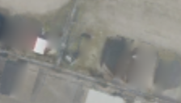

## 8. UV fusion + Shadow guard — 차량 주변의 어두운 그림자도 제외하기

**한 문장으로:** 차량 차체를 제외한 뒤에도 남는 어두운 흔적을 줄이려고, 차량 근처의 유난히 어두운 관측까지 빼고 합성한다.

### 예를 들면

흰 차의 차체는 검출 마스크 안에 들어가지만, 옆으로 드리운 그림자는 밖에 남을 수 있다. 차체만 제외하면 그 그림자가 바닥 Texture에 섞이므로 추가로 걸러낸다.

### 어떻게 작동하나

1. 차량 주변 반경 18 texel을 살펴본다.
2. 비차량 주변 평균 밝기의 0.72배보다 어두운 픽셀을 추가 제외한다.
3. 남은 배경 관측으로 UV fusion을 수행한다. 사진 아래 가운데 결과는 마스크가 아니라 이 과정을 마친 최종 Texture다.

### 이번 파일럿에서 실제로 한 일

61×61 비차량 주변 평균 밝기와 차량 주변 18 texel 조건을 사용했다. 이후 합성·미관측부 보간·출력 표현은 UV fusion과 동일하다.

### 결과와 해석

차량 위치 PSNR: **B 21.00 dB / C 22.23 dB**.

발표에 포함한 실행 방법 중 B/C 차량 위치 PSNR과 LPIPS가 가장 좋았다. 다만 C의 정적 PSNR은 UV fusion보다 조금 낮아, 제거와 바닥 보존이 항상 함께 좋아지지는 않았다.

### 무엇을 조심해야 하나

진짜 그림자를 이해한 분할 모델이 아니라 위치와 밝기의 휴리스틱이다. 원래 어두운 아스팔트나 표식도 제외할 수 있으며, 모든 그림자를 지운다는 보장은 없다.

| 차량이 있는 입력 | 최종 Texture | 실제 빈 배경(2026) |
|---|---|---|
|  |  |  |

사진은 C의 첫 고정 평가 OBB 주변을 동일 범위로 자른 결과다. 인접 차량·그림자는 평가 폴리곤 밖일 수 있으며, 화면 전체가 해당 PSNR의 평가 영역이라는 뜻은 아니다.

