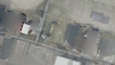

## 9. Geometry + Fusion init — 좋은 Texture에서 학습을 시작하기

**한 문장으로:** Geometry mask baking의 출발점을 평균색 대신 UV fusion 결과로 바꾼다.

### 예를 들면

그림을 처음부터 그리는 대신 어느 정도 깨끗한 밑그림에서 시작하는 방식이다. 다만 이후 잘못된 관측을 계속 맞추면 밑그림의 장점이 사라질 수 있다.

### 어떻게 작동하나

1. UV fusion으로 초기 Texture를 만든다.
2. Geometry mask로 차량 관측을 제외한다.
3. 같은 손실과 600회 baking으로 초기 Texture를 다시 최적화한다.

### 이번 파일럿에서 실제로 한 일

S와 최적화 설정은 Geometry mask와 같고 Texture 초기값만 fusion 결과로 바꾼 분리 실험이다.

### 결과와 해석

차량 위치 PSNR: **B 19.94 ± 0.17 dB / C 21.33 ± 0.10 dB**.

Geometry mask보다 C의 차량 위치 PSNR이 개선됐지만 B는 거의 같았다. 직접 UV fusion보다는 두 장면 모두 낮아, 좋은 초기값을 넣는 것만으로 합성 결과의 이득을 보존하지는 못했다.

### 무엇을 조심해야 하나

초기값은 정답을 고정하는 장치가 아니다. 학습 손실과 관측 선택이 같은 한, 600회 업데이트 후에는 다른 색으로 이동할 수 있다.

| 차량이 있는 입력 | 최종 Texture | 실제 빈 배경(2026) |
|---|---|---|
|  |  |  |

사진은 C의 첫 고정 평가 OBB 주변을 동일 범위로 자른 결과다. 인접 차량·그림자는 평가 폴리곤 밖일 수 있으며, 화면 전체가 해당 PSNR의 평가 영역이라는 뜻은 아니다.

