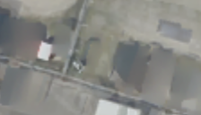

## 10. Geometry + Spatial prior — 관측이 부족하면 주변과 자연스럽게 연결하기

**한 문장으로:** Fusion 초기값에서 baking하되, 잘 안 보인 위치는 주변과 매끄럽게 연결하고 처음 추정값에서도 너무 멀어지지 않게 한다.

### 예를 들면

관측이 충분한 바닥은 사진을 믿고, 계속 차에 가려진 구멍은 주변 바닥을 참고한다. 다만 매끄러운 바닥을 선호하다가 실제 차선도 흐려질 수 있다.

### 어떻게 작동하나

1. Geometry mask와 UV fusion 초기값을 사용한다.
2. 배경 관측이 적은 위치에서 인접 Texture 값의 큰 차이를 더 강하게 억제한다. 이것이 가중 TV이다.
3. 거의 미관측인 위치는 초기 fusion 보간값에서 멀어지지 않게 anchor를 추가한다.

### 이번 파일럿에서 실제로 한 일

공통 손실에 0.01×가중 TV와 0.05×anchor를 추가했다. 이 Geometry 변형에는 shadow guard를 추가하지 않았다.

### 결과와 해석

차량 위치 PSNR: **B 20.39 ± 0.23 dB / C 21.74 ± 0.11 dB**.

Geometry + init보다 두 장면의 차량 위치 PSNR이 높았다. 하지만 직접 UV fusion에는 미치지 못해, 이번 설정에서는 공간 규제만으로 직접 합성을 대체하지 못했다.

### 무엇을 조심해야 하나

주변처럼 매끈하다는 가정은 규칙적인 아스팔트에는 맞을 수 있지만, 가려진 차선·표식·작은 구조를 정확히 복원하는 근거는 아니다.

| 차량이 있는 입력 | 최종 Texture | 실제 빈 배경(2026) |
|---|---|---|
|  |  |  |

사진은 C의 첫 고정 평가 OBB 주변을 동일 범위로 자른 결과다. 인접 차량·그림자는 평가 폴리곤 밖일 수 있으며, 화면 전체가 해당 PSNR의 평가 영역이라는 뜻은 아니다.

