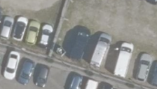
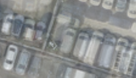
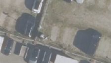

## 11. DINO-SSIM soft — 픽셀을 얼마나 믿을지 학습하기

**한 문장으로:** 단번에 사용/제외하지 않고, 영상의 특징에서 각 위치의 불확실성을 예측해 관측의 기여도를 조절한다.

### 예를 들면

예측과 입력의 밝기·대비·구조가 많이 다르면 신뢰하기 어려운 관측으로 볼 수 있다. 이 차이를 DINO 특징과 연결해 비슷한 특징에도 비슷한 가중치를 주려는 방향이다.

### 어떻게 작동하나

1. 학습 사진과 공통 L2 warm-up의 예측을 준비한다.
2. 변형 SSIM의 밝기·대비·구조 오차 곱을 목표로, DINO 특징을 입력받는 작은 MLP가 불확실성을 학습한다.
3. 불확실성이 클수록 작은 inverse-variance 가중치 S를 주고, 그 S를 고정한 채 baking한다.

### 이번 파일럿에서 실제로 한 일

NeRF On-the-go의 일부 아이디어만 옮겼다. 원 논문은 uncertainty와 NeRF를 분리된 gradient로 함께 학습하고 유사 특징 규제·dilated sampling을 사용하지만, 이번에는 고정 warm-up과 box-window target을 사용했다.

### 결과와 해석

차량 위치 PSNR: **B 18.99 ± 0.20 dB / C 18.62 ± 0.24 dB**.

두 장면 모두 불확실성이 하한 0.1에 붙어 S가 약 50으로 같아졌다. 서로 다른 위치를 다르게 선택하는 능력을 얻지 못한 실패다. L2와 비슷한 점수만으로 제거 성공이라고 해석할 수 없다.

### 무엇을 조심해야 하나

S는 0–1 확률이 아니므로 1보다 클 수 있다. 모든 S가 50으로 같아도 색 정규화에 대한 데이터 손실의 상대 크기는 달라져, L2와 수치가 완전히 같지는 않을 수 있다.

| 차량이 있는 입력 | 최종 Texture | 실제 빈 배경(2026) |
|---|---|---|
|  |  |  |

사진은 C의 첫 고정 평가 OBB 주변을 동일 범위로 자른 결과다. 인접 차량·그림자는 평가 폴리곤 밖일 수 있으며, 화면 전체가 해당 PSNR의 평가 영역이라는 뜻은 아니다.

원 논문 연결: [NeRF On-the-go](https://arxiv.org/abs/2405.18715). 원 논문 전체 성능과 위 파일럿 수치를 구분해야 한다.

