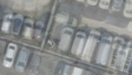

## 12. DINO-cosine soft — RGB 색보다 특징 차이로 신뢰도 정하기

**한 문장으로:** 입력과 예측의 색이 아니라 DINO 특징의 차이로 불확실성을 학습하고, 관측을 연속 가중치로 반영한다.

### 예를 들면

같은 바닥이 조명 때문에 밝아진 경우와 바닥 위에 차량이 생긴 경우를 단순 RGB 차이만으로 나누기는 어렵다. 특징 공간의 차이를 사용해 이를 구분하려는 시도다.

### 어떻게 작동하나

1. 입력과 L2 warm-up 예측에서 DINO 특징을 추출한다.
2. 두 특징의 cosine 유사도로 불일치 정도를 계산하고, 특징→불확실성 변환을 학습한다.
3. S=1/(2σ²)의 연속 가중치를 고정해 baking한다. 다음 hard 방법과 같은 σ를 사용한다.

### 이번 파일럿에서 실제로 한 일

WildGaussians의 DINO 기반 uncertainty 학습을 참고한 soft 대조군이다. 원 논문의 최종 binary 선택, Gaussian appearance와 density control을 모두 포함한 모델이 아니다.

### 결과와 해석

차량 위치 PSNR: **B 18.65 ± 0.12 dB / C 18.34 ± 0.28 dB**.

이번 조건에서는 B/C 차량 위치 PSNR이 L2보다 낮았다. 의미 특징을 사용한다는 사실만으로 차량 제거가 개선되지는 않았다.

### 무엇을 조심해야 하나

DINO 특징도 차량 정답 마스크가 아니다. 리사이즈와 14픽셀 patch 단위 특징이 작은 항공 차량에 불리할 가능성이 있지만, 그 원인을 별도로 분리 검증한 결과는 아니다.

| 차량이 있는 입력 | 최종 Texture | 실제 빈 배경(2026) |
|---|---|---|
|  |  |  |

사진은 C의 첫 고정 평가 OBB 주변을 동일 범위로 자른 결과다. 인접 차량·그림자는 평가 폴리곤 밖일 수 있으며, 화면 전체가 해당 PSNR의 평가 영역이라는 뜻은 아니다.

원 논문 연결: [WildGaussians](https://arxiv.org/abs/2407.08447). 원 논문 전체 성능과 위 파일럿 수치를 구분해야 한다.

