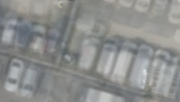

## 13. DINO-cosine hard — 같은 불확실성으로 사용/제외를 결정하기

**한 문장으로:** 앞 방법과 똑같이 학습한 불확실성을 사용하되, 일정 기준을 통과한 관측만 사용한다.

### 예를 들면

믿기 어려운 관측을 조금씩 남기는 대신 아예 빼는 방식이다. 잘 작동하면 차량의 기여를 강하게 억제하지만, 기준이 너무 엄격하면 바닥 사진까지 거의 모두 잃는다.

### 어떻게 작동하나

1. DINO-cosine soft와 동일한 σ를 사용한다.
2. 1/(2σ²)>1인 픽셀은 S=1, 나머지는 S=0으로 만든다. 이 기준은 “정적 확률 50%” 같은 의미가 아니다.
3. 선택된 관측으로 평균 초기값에서 600회 baking한다.

### 이번 파일럿에서 실제로 한 일

WildGaussians는 큰 gradient가 Gaussian densification에 영향을 주는 문제 때문에 binary mask를 사용한다. 우리 고정 Texture에는 그 과정이 없으며, 고정 S로만 규칙을 옮겼다. 원 논문의 우열을 평가한 결과가 아니다.

### 결과와 해석

차량 위치 PSNR: **B 19.60 ± 0.00 dB / C 20.01 ± 0.00 dB**.

일부 차량 위치 PSNR과 LPIPS는 L2보다 좋아졌지만, B/C 지면 ROI의 약 94.8%/90.6%가 채택 관측의 지지를 잃었다. 넓은 영역이 평균 초기값에 남을 수 있으므로 점수만으로 배경 복원을 주장할 수 없다.

### 무엇을 조심해야 하나

제외를 많이 했다는 것과 차량만 정확히 제외했다는 것은 다르다. 원래 배경 관측이 있었더라도 마스크가 이를 지우면 새 데이터로 Texture를 고칠 수 없다.

| 차량이 있는 입력 | 최종 Texture | 실제 빈 배경(2026) |
|---|---|---|
|  |  |  |

사진은 C의 첫 고정 평가 OBB 주변을 동일 범위로 자른 결과다. 인접 차량·그림자는 평가 폴리곤 밖일 수 있으며, 화면 전체가 해당 PSNR의 평가 영역이라는 뜻은 아니다.

원 논문 연결: [WildGaussians](https://arxiv.org/abs/2407.08447). 원 논문 전체 성능과 위 파일럿 수치를 구분해야 한다.

