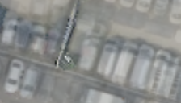

## 14. SAM-region vote — 큰 오차를 영역 단위로 정리하기

**한 문장으로:** 오차가 큰 픽셀을 찾은 뒤, 그 픽셀이 많은 SAM 영역을 통째로 제외한다.

### 예를 들면

한 영역의 픽셀 100개 중 45개가 큰 오차라면 40%를 넘으므로 영역을 제외한다. 영역 경계는 깔끔해질 수 있지만, 처음 오차 판정이 틀리면 바닥 전체를 지울 수도 있다.

### 어떻게 작동하나

1. L2 warm-up의 잔차가 영상의 중앙값보다 큰 위치를 제외 후보로 만든다.
2. 3×3 주변 다수결로 조각난 후보를 정리한다.
3. 저장된 SAM 분리 영역에서 제외 후보가 40%를 넘으면 영역 전체를 제외하고, 나머지는 사용한다.

### 이번 파일럿에서 실제로 한 일

Robust 3D Gaussian Splatting의 object-aware masking 취지만 단순 차용했다. 원 논문의 logistic 결정 경계와 SAM IoU 절차는 구현하지 않았다. HuGS와도 후보 생성 및 영역 투표 기준이 다르다.

### 결과와 해석

차량 위치 PSNR: **B 17.15 ± 0.19 dB / C 19.92 ± 0.02 dB**.

B의 차량 위치 PSNR은 L2보다 낮고 C는 높았다. 하지만 지면의 무지지 비율이 B 약 46.7%, C 약 87.6%로 커서 과도한 제외가 주요 진단이었다.

### 무엇을 조심해야 하나

영역을 나누는 SAM과 정적/동적 판단은 별개의 역할이다. 차량으로 잘못 선택한 바닥을 SAM이 자동으로 되살려 주는 것은 아니다.

| 차량이 있는 입력 | 최종 Texture | 실제 빈 배경(2026) |
|---|---|---|
|  |  |  |

사진은 C의 첫 고정 평가 OBB 주변을 동일 범위로 자른 결과다. 인접 차량·그림자는 평가 폴리곤 밖일 수 있으며, 화면 전체가 해당 PSNR의 평가 영역이라는 뜻은 아니다.

원 논문 연결: [Robust 3D Gaussian Splatting (Ungermann et al., 보충)](https://arxiv.org/abs/2408.11697). 원 논문 전체 성능과 위 파일럿 수치를 구분해야 한다.

