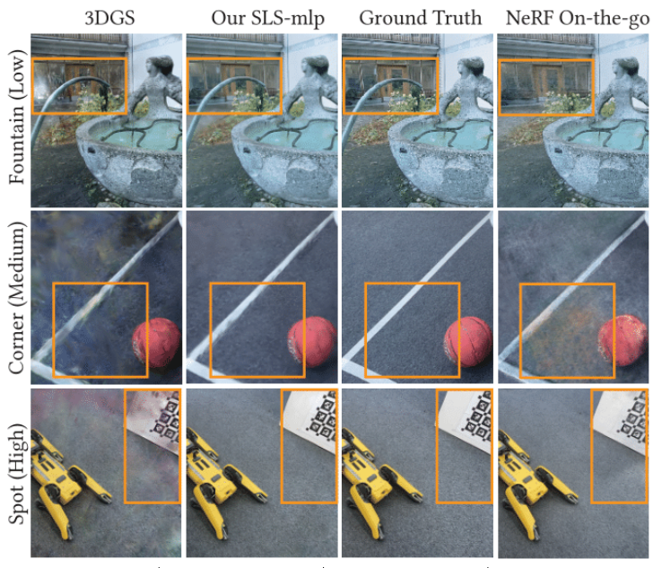

## 15. SpotLessSplats — 의미가 비슷한 픽셀을 함께 판단하기

**실행 상태: 문헌 검토만 수행. 아래 원 논문 이미지를 우리 파일럿의 실행 결과로 해석하면 안 된다.**

**한 문장으로:** RGB 오차만 보지 않고, Stable Diffusion 특징에서 의미적으로 비슷한 영역을 찾아 distractor 영향을 줄인다.

### 예를 들면

차량 가운데 일부가 바닥과 비슷한 색이면 그 부분만 오차가 작아 마스크에 구멍이 날 수 있다. 의미 특징으로 연결된 영역을 같이 판단해 물체의 범위를 더 잘 다루려는 접근이다.

### 핵심 동작

1. Stable Diffusion을 이미지를 새로 그리는 용도가 아니라 특징 추출기로 사용한다.
2. 공간 clustering의 투표 또는 특징을 입력받는 inlier MLP로 사용/제외를 판단한다. MLP에는 잔차로 확실한 부분만 약한 supervision을 준다.
3. 점진적 masking, 여러 batch의 잔차 분포 추적, Gaussian 활용도 기반 pruning을 함께 사용해 3DGS 학습과 마스크의 충돌을 줄인다.

### 우리 실험과의 관계

고정 Texture에도 특징 기반 영역 선택은 옮길 수 있다. 그러나 Gaussian을 생성·제거하는 부분은 그대로 적용할 대상이 없다. 이번 DINO 실험은 SD 특징이나 이 supervision을 쓰지 않았으므로 SpotLessSplats의 재현으로 부르면 안 된다.

위 그림은 원 논문의 결과 인용이다. 우리 B/C 영상의 결과나 정량 비교 대상이 아니다. [원문](https://arxiv.org/abs/2406.20055).

