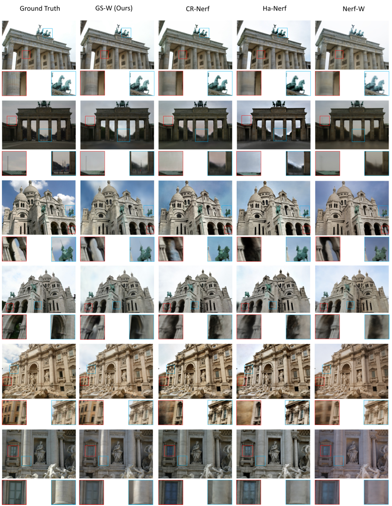

## 16. GS-W — 외관 변화와 가려짐을 따로 처리하기

**실행 상태: 문헌 검토만 수행. 아래 원 논문 이미지를 우리 파일럿의 실행 결과로 해석하면 안 된다.**

**한 문장으로:** 조명·날씨에 따른 외관 변화는 appearance 모델로 설명하고, 가려진 관측은 학습된 visibility map으로 덜 사용한다.

### 예를 들면

같은 벽이 햇빛 때문에 밝아진 것은 벽이 사라진 것이 아니다. 반대로 벽 앞을 사람이 가린 관측은 벽 색을 학습하는 데 쓰지 않는 편이 좋다. 두 현상을 다른 장치로 다룬다.

### 핵심 동작

1. 각 Gaussian의 고유한 appearance와 촬영 조건에 따른 dynamic appearance를 나누어 모델링한다. 여기서 dynamic appearance는 이동 물체 자체를 뜻하지 않는다.
2. 별도 U-Net이 2D visibility map을 만들고, 낮은 visibility 위치의 영상 손실 기여를 줄인다.
3. 모든 픽셀을 안 보인다고 하면 학습을 피할 수 있으므로, visibility를 1로 유도하는 정규화로 퇴화를 막는다.

### 우리 실험과의 관계

우리 S도 학습형 visibility로 만들 수 있다는 근거다. 다만 이번에는 이 U-Net이나 Gaussian별 appearance를 실행하지 않았다. 우리 전역 affine 색보정은 훨씬 제한적인 보정이다.

위 그림은 원 논문의 결과 인용이다. 우리 B/C 영상의 결과나 정량 비교 대상이 아니다. [원문](https://arxiv.org/abs/2403.15704).

