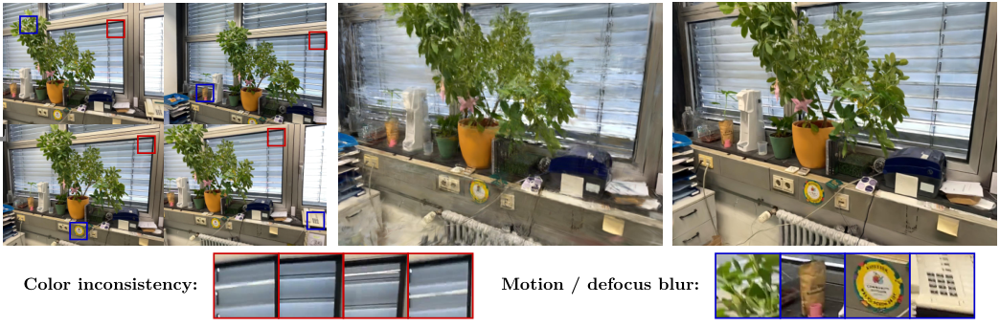

## 17. Robust Gaussian Splatting — 차량보다 촬영 오차를 보정하는 연구

**실행 상태: 문헌 검토만 수행. 아래 원 논문 이미지를 우리 파일럿의 실행 결과로 해석하면 안 된다.**

**한 문장으로:** 카메라 포즈, motion/defocus blur, 사진 간 색 차이 때문에 재구성이 망가지는 문제를 줄인다.

### 예를 들면

차량이 하나도 없어도 사진이 흔들리거나 위치가 조금 어긋나면 입력과 예측의 차이가 커진다. 이 차이를 모두 차량 탓으로 보면 멀쩡한 바닥까지 제외할 수 있다.

### 핵심 동작

1. 카메라 포즈를 Gaussian 분포로 모델링해 motion blur와 포즈 보정을 함께 다룬다.
2. 투영된 Gaussian의 covariance에 보정을 더해 defocus blur를 다룬다.
3. 이미지별 affine 색변환으로 색 불일치를 보정한다.

### 우리 실험과의 관계

정적 배경에서도 잔차가 커질 수 있으므로 정합·색보정이 중요하다는 보조 레퍼런스다. 이름이 비슷한 Robust 3D Gaussian Splatting for Novel View Synthesis in Presence of Distractors와 다르며, 후자가 SAM-region 실험과 연결되는 동적 제거 연구다.

위 그림은 원 논문의 결과 인용이다. 우리 B/C 영상의 결과나 정량 비교 대상이 아니다. [원문](https://arxiv.org/abs/2404.04211).

